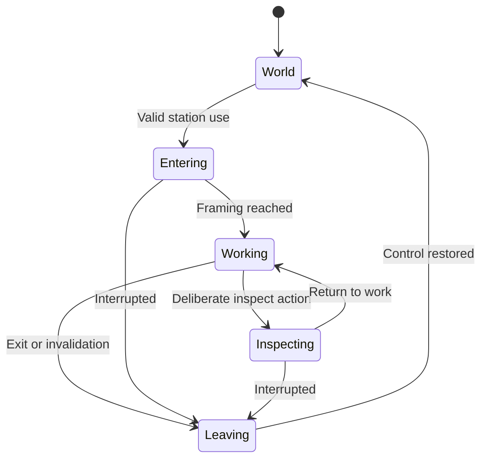

# Immersive Brewing — Close-Up, Hands-On Workshop Overhaul

**Coding-agent implementation handoff • November 13, 2026**  
**Starting point:** Immersive Brewing development version 1.2.0, Minecraft 1.20.1, Forge 47.4.23, Java 17  
**Priority:** Make brewing feel like manipulating an alchemical apparatus, with a close view into the vessel and very little interface between the player and the work.

## 1. The assignment

Rebuild the player-facing workshop experience around a camera that moves above and toward the actual workstation, tools that follow the player's actions, and materials that visibly respond at the contact point. Ordinary brewing must be possible without opening a full-screen station inventory, recipe-planning screen, minigame, or result screen.

The requested experience is concrete: approach a kettle, lean into a clear view of its contents, lift and tip ingredients, steer a paddle through the brew, adjust a physical burner, watch the reaction develop, and fill bottles. The player should spend her attention on the liquid and tools. Text should support observation when needed.

This is a further overhaul of the **current 1.2.0 implementation**, not a replay of the earlier 1.1.0-to-1.2.0 handoff. The current code already has physical process models, direct loading, tool leases, shared snapshots, and recovery. Preserve those investments where they work. Replace or substantially refactor the camera, setup flow, input presentation, workstation geometry, rendering, and animations as necessary to deliver this brief.

All new names, numerical targets, schemas, and behaviors below are proposed requirements unless explicitly identified as existing. They are not claims that an API already exists.

### Non-negotiable outcomes

1. **A real close-up camera:** the rendered camera changes position as well as orientation; the kettle interior is clearly visible. Turning the player's head and multiplying FOV is insufficient.
2. **A complete path without mandatory menus:** prepare, load, select a supported transformation, brew, bottle, purify/reclaim when desired, and store through apparatus interactions. An optional searchable reference book is welcome.
3. **Continuous manipulation:** taking, moving, tipping, contacting, releasing, and returning objects form readable sequences. A click should not simply teleport an item and briefly draw a stream afterward.
4. **Causal material feedback:** tool contact produces local wakes, displacement, grinding, dissolution, and recovery from mistakes. Decorative particles do not substitute for this.
5. **A shared world:** another player sees the same work. Close-up mode does not create a private duplicate station, remote reach, or a second inventory.
6. **Comfortable repetition:** batch handling, forgiving targets, accessible controls, and short purposeful actions. No compulsory endless circles, repeated button mashing, or additional cleaning chores.
7. **Evidence of the actual experience:** a real-input first-batch recording and playtests, in addition to simulation and network tests.

## 2. Research baseline and verified gaps

### Revisions inspected

| Project | Pinned revision | Relevant declaration |
| --- | --- | --- |
| Immersive Brewing | `8f1faf76742a0e1f7bf17d12f5ca936df1bb2a31` | 1.2.0; Minecraft 1.20.1; Forge 47.4.23 |
| Hands-On Delight | `8c39af5d8f1330c0e074b57c11237eafc4fc59b7` | 1.4.0; inspected build targets 1.20.1 and declares Diegesis 1.0.0-beta.8 |
| Diegesis | `2abf77a2967612231190dc92a609699fcda6af82` | Current reference source for station scenes, camera movement, and interaction presentation |

These are source-tree declarations, not independently verified published-release or binary-compatibility claims. [S01] [S02]

This document is based on static source review, the current implementation report, the earlier November 12 handoff, and visual inspection of the committed `kettle-hands-on-stirring.png` screenshot. No Minecraft build, client session, dedicated server, or performance test was run for this research. Results quoted from the repository remain the implementation author's reported results.

Before editing, record the working branch and HEAD, read applicable repository instructions, and compare against the pinned revision. Incorporate subsequent fixes rather than reverting them to match this document.

### What is already there, and what still needs to change

| Verified current behavior | Why it matters | Required refinement |
| --- | --- | --- |
| `ClientWorkshop.frame()` computes a yaw/pitch toward the block; `turnCamera()` changes the player's rotation; `onFov()` applies a `0.86` multiplier. | The camera stays at the player's eye position. Vessel walls can dominate the view even while the process is called hands-on. | A station-relative camera rig with a visible interior, comfortable transitions, collision handling, and correct picking. [S03] |
| `WorkshopScreen` is a transparent, non-pausing `Screen` over the world. | Using a `Screen` for cursor capture is not itself a problem. Its current visual treatment is the issue. | Keep a thin input host if useful; remove the persistent dashboard feel. [S04] |
| `WorkshopScreen.render()` always builds a top title/cue panel and a bottom key list, with more text for the carried tool and tutorials. | Several text bands compete with a small apparatus. The committed stirring screenshot visibly demonstrates this imbalance. | Default to restrained contextual cues and progressive teaching; preserve optional verbose/narrated guidance. [S04] [S05] |
| The kettle's book target sends `BOOK`; server handling submits a catalog query, and the documented first batch uses the plan screen's “Set out the batch.” | Normal kettle setup still depends on a separate planning interface. | Add direct, server-validated setup and an in-world recipe page; keep expanded search optional. [S06] [S07] |
| `StationBlockEntity.openDrawer()` uses `NetworkHooks.openScreen`. | The “drawer” is an actual station menu, not an integrated physical supply surface. | Provide compact supply access within the working view; retain the old menu for explicit maintenance/migration only. [S08] |
| A carried kettle bottle or dose is drawn at a fixed position above the mouth. Pour/fill effects use the most recent transfer event and a short stream window. | The action has little visible travel, grip, tipping, or coordination between source and destination. | Persistent transfer presentation with source, path, pose, contact/commit point, and return animation. [S09] |
| The kettle already draws liquid, moving ingredient items, reaction trouble, heat, tools, and cups. | This is a useful starting point, not an absence of visuals. The liquid is principally a flat surface, with ingredients orbiting from aggregate circulation. | Add local paddle response, surface motion, material-specific incorporation, and coherent contact heights. [S09] |
| Mortar and alembic already have direct productive targets and physical state. | They should not be described as still relying exclusively on the old minigames. | Improve their composition and manipulation; fill remaining menu-only paths such as mode/setup handling. [S06] [S10] |
| `KettleProcess`, `ReactionFamily`, and `ToolTrack` already model thermal inertia, dissolution, circulation, bounded movement, trouble, and quality. | A second replacement simulation is unnecessary unless a demonstrated interaction requires it. | Extend only the missing spatial/operation information; keep the tested behavior and conservation boundaries. [S11] |
| Workshop profile `presentation` references are parsed, but ADR-5 reserves their use for a future presentation layer. | Authors cannot yet use that field as a complete implemented visual contract. | Implement a bounded client presentation-profile system and graceful fallbacks. [S12] |
| The report leaves real playtests, two-real-client dedicated-server work, shader checks, moving-video review, and audio review open. | Automated completion is not proof of tactile quality. | Treat these as release gates, with recorded evidence. [S13] |

The existing screenshot shows the kettle largely from the side, with a small visible opening and substantial text across the screen. That is evidence about the captured composition, not a claim that every possible user configuration looks identical. The camera code independently explains why the present focus mode cannot guarantee an overhead working view. [S03] [S05]

### What to borrow from the reference

Hands-On Delight's cooking-pot scene explicitly defines a camera position `[8, 41, -21]`, target `[8, 6.5, 8]`, and FOV `30` in its scene coordinates. It also defines a spoon, vessel drop zone, liquid region, and compact inventory presentation. Its `PotBehavior` handles spoon movement, floating ingredients, liquid appearance, additions, and serving. The important reference is the connection between framing, object movement, and material response. [S14] [S15]

Diegesis' `CameraRig` supports position, target, transitions, alternate shots, and aspect-ratio framing. Its camera mixin actually changes the render camera's position. Study these mechanisms, including their interaction with other camera mods; do not assume an FOV event can translate the camera. [S16] [S17]

Retain Brewing's own potion economy and identity. Do not copy the reference's star unlocks, bonus servings, unattended cooking policy, or Farmer's Delight dependency into Brewing merely because its presentation is appealing.

## 3. The target first-batch experience

Implement this as the first complete vertical slice before spreading work across every station:

1. The player places three water bottles, nether wart, sugar, fuel, and a paddle at the kettle. Each lands in an obvious physical position with a short placement motion.
2. Empty-hand use moves the camera into an oblique overhead view. The opening, liquid surface, paddle, dose tray, burner, and bottle rail are readable together.
3. The apparatus identifies a supported Swiftness route from the staged contents. A small page on the book stand shows the resulting potion, three servings, the two ingredient steps, and exact costs. If there is ambiguity, the player turns between a small number of valid route pages. No full-screen planner is required.
4. The player lifts a bottle, brings it over the mouth, and tips it. A stream leaves the bottle's neck, ripples start where it meets the liquid, and the reserved empty bottle returns to the rack. An explicit batch action repeats the handling for the other bottles.
5. The player turns the burner. The flame responds immediately; bubbles and convection follow with the existing thermal delay. The correct region is recognizable from the material and optional apparatus markings.
6. Nether wart is tipped in. Pieces land at the actual impact point and infuse through the water. The paddle pushes them, leaves a wake, and develops circulation.
7. When the base is ready, the player adds sugar. Grains sink and dissolve along the paddle's path; the potion's color and effect-specific appearance develop as the reaction proceeds.
8. The player eases the heat, rests the paddle, and watches the surface settle. Quiet, stable material communicates completion without a result modal.
9. A bottle moves under the outlet, fills visibly, and returns to its slot. The kettle level falls. The player takes the potions or packs them into a carrier.

An experienced player must be able to do the same journey with normal tooltips disabled. A new player can enable concise, contextual instructions. Both paths use the same recipes, resources, and quality rules.

A later batch introduces optional mortar preparation. It should feel like an additional useful craft, not a mandatory tax on every brew.

## 4. Recompose the apparatus before polishing effects

Design each workstation for both its world silhouette and its close working view. A model that looks acceptable from across a room may hide the exact surface the player needs to manipulate.

| Station | Main composition | Supporting elements |
| --- | --- | --- |
| Kettle | Broad, readable open liquid surface; paddle enters from the player's side; rim leaves the work visible | Dose tray to one side, bottles in a stable foreground rail, burner control within view, small book stand offset from the vessel |
| Mortar | Bowl floor and material occupy the center; pestle contact remains visible | Scraper/rest and dose cup near the rim; finished packets on a separate small shelf |
| Alembic | Boiler, vapor path, condenser, diverter, and receiver read as one connected mechanism | Coolant level and its valve are distinguishable from burner controls; waste destination is visibly separate |
| Rack | Bottle positions, labels, and carrier cradle are directly accessible | Reservation ghosts appear only when useful; no always-visible inventory grid |

For the kettle, lower or shape the near rim where necessary, widen the visible opening within a Minecraft-sized silhouette, and keep dose cups from hiding behind the vessel. Preserve block IDs and placement behavior. Do not silently turn the station into a multiblock or require a new room layout.

Parts may extend slightly beyond a block, as some current presentation already does, but test adjacent stations and walls. Update render bounds, occlusion, picking, and server part geometry together. Prefer a model that fits the usable space over disabling frustum culling everywhere.

Use warm copper, dark iron, worn wood, pale ceramic, clear glass, linen, and restrained alchemical accents. Preserve Minecraft's pixel density and readable shapes. Give each moving component a meaningful pivot and each tool a defined grip and contact point. A cuboid is appropriate when it represents a physical object; a collection of unarticulated boxes is not a finished apparatus.

Do not make optional shaders, bloom, depth of field, dynamic lighting mods, or custom GPU features necessary to understand the workstation.

## 5. Implement a real station camera

### 5.1 Camera contract

Introduce a client-only focus controller with an explicit lifecycle:



The controller owns the temporary render-camera pose and input capture. The actual player stays where she is, remains vulnerable, and retains normal world permissions. Do not teleport the player, move a server entity to the pot, or modify global FOV settings to achieve the effect.

Start from the camera pose already produced by Minecraft and any compatible camera mod. Interpolate to a station-relative rig. On exit, hand control back to the live ordinary camera cleanly. Avoid permanently changing the player's yaw/pitch as the current framing code does; where compatibility requires a temporary override, capture and restore it deliberately.

Suggested starting composition targets, to tune through play:

| Parameter | Starting target | Constraint |
| --- | --- | --- |
| Kettle working angle | Roughly 50–65 degrees downward from horizontal | Oblique enough to see tool depth, steep enough to see the near-side liquid |
| Focus FOV | Approximately 35–50 degrees vertical | Fit the apparatus; do not blindly copy the reference's 30-degree setting |
| Entry/exit | About 0.3–0.5 seconds, eased | Immediately interruptible; no long theatrical fly-in |
| Framing | Apparatus approximately 55–75% of view width; kettle opening roughly 35–55% | Controls and relevant supplies must remain visible and clickable |
| Surface feedback | Visible on the next rendered frame after local movement | Server still authorizes productive work |
| Camera roll | Zero | No mandatory shake, sway, head bob, or motion blur |

These are design targets, not measured current performance or universal fixed values.

### 5.2 Fit the scene, not just its center

Define authored bounds for the active work surface and required controls. Fit them against both horizontal and vertical FOV with padding. At narrow aspect ratios, widen or pull back within limits rather than cropping the bottle rail. At ultrawide ratios, keep the main work near the center instead of pushing controls to distant edges.

Use station-local coordinates rotated by block facing. Never key the rig to world north. Validate all four facings, raised workstations, floor placement, and close neighboring equipment.

Provide a small set of useful compositions:

- **Working:** the stable primary shot; all normal brewing can be completed here.
- **Inspect:** an optional closer view of material or condensate.
- **Handling:** a modest adjustment when explicitly operating a bottle rail or supply area, only if needed.

Do not move the camera every time a dose lands or a reaction phase changes. Lock framing while dragging a tool, pouring, or manipulating a valve. An action must not move its own target away from the cursor. Neighbor-station travel is deliberate and validates reach at the new station; edge-hover travel should be optional and disabled during tool capture.

### 5.3 Obstruction and restoration

Check the entire transition path and destination against nearby block collision shapes, with clearance for the camera's near plane. Try authored alternative offsets or a shorter framing distance when blocked. If no comfortable close-up is possible, use the eye-position working mode and a brief explanation. Do not make walls transparent to reveal unrelated rooms or let the camera pass through terrain.

The scene's own lid, handle, or near rim can be redesigned, moved as a real part, or selectively hidden for the local focus view if necessary. Any view-only hiding must be scoped to the focused station, restore on every exit/reload, and leave observers' rendering intact. It must not change interaction permissions.

Exit, death, damage, teleport, dimension change, disconnect, station removal, focus loss, resource reload, another screen taking over, and camera-mod changes all need defined cleanup. Release held controls, remove local hand overrides, clear predicted transfers, restore mouse capture and camera ownership, and revalidate any resume. Never leave the player trapped in a stationary camera.

### 5.4 Picking must use the rendered camera

Replace independent guessed camera math with a shared per-frame view/projection representation, or prove exact agreement with Minecraft's final matrices. Cursor rays, projected labels, hit highlights, liquid-plane intersections, and actual rendering must use the same camera pose and effective FOV. Include interpolation, window dimensions, GUI scale, aspect ratio, and mirroring.

Keep the server's authority separate: validate actual player reach, external obstruction, access permission, station identity, part ID, lease, phase, and resources. A render camera is never proof that the player can reach something. Adapt the existing `WorkshopGeometry` contract carefully; its current visibility check tolerates the station's own shell but rejects intervening blocks. Recheck obstruction during continuing actions when relevant. [S18]

Server-approved part/contact geometry must remain fixed independently of client resource-pack models. Cosmetic hit-target enlargement must select an allowed part and cannot grant access through a wall.

### 5.5 Accessible camera choices

Offer smooth close-up, instant close-up, and eye-position working modes. Separate “reduce motion” from “disable helpful framing.” A player who dislikes animated camera travel may still want a stationary overhead view.

Preserve current accessibility choices during config migration. Do not silently give existing no-camera users a moving camera. New installations can default to the close-up mode. A deliberate setting enables it for existing users.

## 6. Remove mandatory menu transitions

### 6.1 Define the boundary precisely

“No mandatory menus” means ordinary productive work can remain in the world view. It does not mean prohibiting every tooltip, key hint, optional inventory strip, text editor, or searchable reference.

| Existing surface | New normal role |
| --- | --- |
| `WorkshopScreen` | Thin cursor/input host and optional contextual help |
| `KettlePlanScreen` | Optional expanded recipe search/inspection; never the only way to start a normal batch |
| Mortar/Kettle/Alembic inventory menus | Explicit maintenance, inspection, automation configuration, and legacy support |
| `NotebookScreen` | Optional reference, searchable catalog, history, settings, and practice entry |
| Rack/carrier screens | Optional bulk organization; ordinary take/place/pack/unpack stays physical |
| Legacy minigame screens | Existing legacy jobs only until their migration/completion policy permits retirement |
| Result screen | No automatic opening for new physical jobs; brief completion feedback and a book entry |

Do not merely put the entire old planner onto a floating rectangle beside the kettle. Its routine information should be reduced to a compact, readable recipe page or recipe card attached to the apparatus.

### 6.2 Direct batch setup

Add a server-owned setup service over the current catalog, plan resolution, staging, and ledger APIs. Both the direct workflow and optional full planner call that service.

1. Derive quantity from the explicitly selected/loaded bottle group, initially preserving one to six servings.
2. Resolve valid routes from the canonical input and staged ingredients using the existing live brewing adapters.
3. If exactly one intended route matches, show its output, quantity, ordered doses, fuel, and relevant remainders on the in-world page.
4. If several routes match, show a small bounded set of choices with clear output identities. Never silently choose by registry order or consume materials while the choice is unresolved.
5. If ingredients are missing, show restrained ghosts at their real holders. Missing fuel appears at the burner, missing containers at the rail.
6. A deliberate physical action—such as taking the first staged bottle after reviewing the displayed batch—accepts that exact preview and starts the reservation transaction. The action must clearly communicate that it starts the displayed batch.
7. Revalidate inventory, quantities, output capacity, recipe identity, and revision atomically. If anything changed, refresh the preview and explain the change before consuming anything.

The simple Swiftness route must work this way. Multistep routes can be laid out on the same book stand or selected through optional catalog search. Once selected, their work stays at the apparatus. Do not require intermediate bottling and reopening screens between Water → Awkward → Swiftness.

Avoid an unbounded search on every cursor move. Debounce content changes and reuse the existing bounded server catalog mechanisms. Distinguish “still searching,” “more routes available,” and “unsupported” accurately.

This change does not introduce arbitrary free-form potion mixing. The recipe system still decides legal transformations. A gesture cannot create a recipe absent from that authority.

### 6.3 Supply handling while focused

Support loading before focus using held-item interaction, and supply selection during focus without leaving the world view. Use the visible hotbar or a compact opt-in inventory strip/drawer. It represents real player slots, not copied scene items. Opening it releases work input and keeps the vessel visible.

Direct a selected item toward a meaningful destination: bottle cradle, dose holder, fuel compartment, tool rest, or coolant opening. Show one destination outline and the amount to transfer. Accept one unit or an explicitly chosen batch quantity; never interpret one pour as permission to consume the entire stack.

Offer contextual **one / batch** actions with clear quantities at the selected object. Keep a rebindable batch shortcut for experienced players, but reduce reliance on the current hidden global `C` mode. Show the active quantity wherever an action will consume or move multiple units, and clear temporary batch state predictably.

Keep special-action precedence correct for recovery batches, water buckets, carriers, normal items, and both hands. One accepted input performs one action. The click that opens focus must not also pour, grab, or activate the object now beneath the cursor.

## 7. Make hands, tools, and transfers continuous

### 7.1 One interaction language

| Intent | Primary interaction | Accessible equivalent |
| --- | --- | --- |
| Take a tool | Click its handle or rest | Select target, activate |
| Work with it | Move its contact point through the material | Bounded assist motion; directional control and chosen effort |
| Put it down | Click its rest or use cancel/put-down | Single rebindable action |
| Pour | Lift source, move above receiver, tip or hold the pour action | Select source and receiver, activate assisted tip |
| Adjust heat/flow | Drag the visible handle/knob or scroll over it | Select control, increase/decrease |
| Collect output | Click the actual bottle/packet | Select output, activate |
| Repeat a safe transfer | Explicit batch action at that source | Rebindable batch action with visible quantity |
| Leave or seal | Immediate exit; lid/clamp for sealing | Separate single-key actions |

Keyboard-only access must work through the same operations and server checks. It must be practical, not merely theoretically possible after hundreds of target-cycling presses.

### 7.2 Tools have contact geometry

Give every tool a grip anchor, working tip/blade, resting pose, constrained working region, and contact state. Render its tip at the same material height used for interaction. Kettle fill level changes must not leave the paddle visibly stirring air or passing through the bottom.

Constrain normal dragging to comfortable work surfaces. Use a generous basin region with soft clamping near the rim, not pixel-perfect tracing. Let the tool lift out intentionally. Stop productive work when it is outside the material, the lease is lost, or samples go stale.

A paddle should lean into movement, resist abrupt reversals visually, and return to rest smoothly. A pestle should have a brief lift/contact/recovery motion. These cosmetic responses must not add unrequested input latency or hidden work.

### 7.3 Transfer timeline and ownership

Represent a visible transfer explicitly: source slot/portion, destination, displayed stack, actor, operation ID, current pose, phase, and accepted commit state. Suggested phases are lift, travel, align, tip, flow, return, and settle. Keep them in a small bounded state machine; do not create a free physics item entity for every moving bottle.

For the first implementation, preserve discrete whole-dose/whole-serving transactions:

- Before commit, the real resource stays owned at its source or in the existing reservation ledger.
- A valid tipping action over a valid receiver requests one transfer with the expected revision and operation ID.
- On server acceptance, ownership moves exactly once. The visual source drains and destination fills coherently around that accepted boundary.
- Rejection returns the object to its authoritative source with a short reason. It cannot show a permanently filled bottle or a completed reaction that the server rejected.
- Interruptions before and after commit resolve according to ownership, never according to which animation frame happened to render.

The local lift and travel can be predicted immediately. Keep authoritative fill progress bounded by accepted state; do not hide network latency by fabricating inventory changes. Handle cancellation, duplicate acknowledgements, reordering, and reconnects.

A held ingredient's pose must also be visible to observers. The current local `carried` value is insufficient for that full presentation. Replicate bounded active-hand/transfer information without sending private inventories. A late observer receives the current pose and phase, not a replay of every prior pour.

### 7.4 Player hands

Show a Minecraft-style hand/forearm gripping the active tool or vessel when it improves clarity. Respect the player's skin, slim/standard model, handedness, and appropriate arm geometry. Avoid a duplicated ordinary held item and a second copy in the workshop grip.

A full-body inverse-kinematics system is not required. Stable grip alignment and a clear tool/material contact matter more. A tool-only rendering preference must remain usable. Other players may see a simpler arm pose while still seeing accurate tool movement.

## 8. Kettle materials and reactions

### 8.1 A small, readable liquid model

Keep server simulation bounded. Add only the spatial information needed to connect approved contact to visible behavior. Use a low-resolution height/flow representation or a small set of analytic waves and local impulses on the client; full fluid dynamics is unnecessary.

The liquid presentation needs:

- A fill level derived from owned, unbottled portions.
- Local depressions/wakes at the paddle and impacts where doses or water land.
- Circulation that continues briefly after the paddle stops and decays with the existing process.
- Ingredient fragments carried by flow, deflected near the tool and rim, and visibly reduced as their material incorporates.
- Foam, sediment, viscosity cues, clarity, and small bubbles derived from the actual relevant state.
- A stable, readable end condition when the batch is ready.

Do not let client-only particle positions decide quality. Material fragments are cosmetic representatives, never additional reagent items. Their approximate distribution should agree with server aggregate/spatial state, and their counts must be capped.

### 8.2 Material-specific additions

| Ingredient presentation | Arrival | Incorporation |
| --- | --- | --- |
| Crystal/powder | Small grains or a short stream from a dose cup | Grains descend, form brief cloudy trails, and dissolve where mixed |
| Fibrous/organic | A few recognizable pieces | Pieces soften, disperse, and leave infusion trails |
| Paste/cream | A cohesive dollop stretches off the vessel | Thick ribbons fold and gradually become uniform |
| Liquid | A continuous stream from a visible neck/lip | A plume spreads from the impact point before blending |
| Magical particulate | A restrained cluster of flakes/motes | Effect-specific motion changes with incorporation and settling |
| Unknown modded ingredient | A bounded neutral representation using its item/model | Generic dissolution with no guessed lore or mandatory preparation |

Preserve the identity of important ingredients long enough to recognize what was added. Do not render every material as three tiny copies of its full inventory item orbiting at the same radius.

### 8.3 Make existing reaction families perceptibly different

The current code already has the families below, including separate heat and agitation trouble. Extend their presentation and, where justified, their operation vocabulary; do not invent a new feature label for behavior already present. [S11]

| Family | Primary material cue | Meaningful handling |
| --- | --- | --- |
| Light foam | Fine froth grows near turbulent contact and hot edges | Slow broad folding and reduced heat allow it to settle |
| Dense sediment | Heavy grains gather below clearer liquid | Sweeps lift and distribute them; final rest clarifies the brew |
| Delicate shimmer | Thin coherent streaks become ragged under harsh treatment | Gentle heat and restrained movement preserve coherence |
| Magma streaks | Thick ribbons soften as warmth reaches them | Warm, deliberate folding incorporates them |
| Suspended bubbles | Trapped pockets expand and release visibly | Calm movement/rest releases gas without violent froth |
| Dark whorls | Dense clouds trail the addition and thin along flow | Mix until persistent concentrated ribbons disperse |
| Aligning glints | Grains dissolve, then glints stabilize in calmer liquid | Stop unnecessary agitation after incorporation |
| Floating motes | Light flakes resist submersion and collect near edges | Gentle sweeps draw them inward and under |
| Generic | Clear, restrained dissolution and simmering | Ordinary heat, mixing, and settling with forgiving conditions |

If a mechanic is described as “sweep the bottom” or “draw material under,” implement an explicit constrained operation/depth state that the server can validate, with an equivalent accessible action. Do not advertise depth-sensitive manipulation while accepting only an undifferentiated 2D circle. Conversely, do not introduce a cumbersome six-axis control scheme: two or three deliberate tool postures are enough.

Retain the existing recoverable nature of mistakes. Foam and heat trouble should have a visible cause and a useful correction. No random forced failures, surprise explosions, or permanent loss from a missed one-frame window are needed.

### 8.4 Heating, resting, and finishing

Let a stable burner setting stay correct; the player need not keep touching it for participation credit. Use the existing plan-based fuel accounting initially. Do not charge a second continuous fuel cost merely because a flame now looks more convincing.

Resting should be visibly quieter: diminishing circulation, settling foam, fewer large bubbles, changing clarity. Keep short natural pauses, but shorten dead waiting when no meaningful choice remains. Do not require constant stirring through a phase whose best action is to stop.

Container-only finishing remains a short fitting/capping operation, preserving the established recipe proof, metadata, and quality. Splash and lingering modifiers must not force a complete second reaction exercise or provide a new quality-farming opportunity.

### 8.5 Bottling that makes physical sense

Align the bottle mouth and the actual outlet. Use a sliding bottle rail, rotating cradle, or articulated spout so the stream follows a plausible path. Avoid the current visual shortcut of a fixed spout emitting a diagonal line to whichever distant bottle slot was selected.

Show the bottle moving under the outlet, filling to a readable level, receiving its stopper where appropriate, and returning. The batch action repeats the sequence at a brisk pace. It may be interrupted between transfers; already completed bottles stay complete and remaining portions stay owned.

Keep bottles recognizable as Minecraft potion items while allowing a more readable in-world fill model. At most one real output exists per serving. The empty container reserved by a charged potion is not also a freely extractable spare bottle.

## 9. Bring the other stations to the same standard

### 9.1 Mortar: work the visible material

The existing mortar already starts work through its pestle and exposes a cup for finishing. Preserve that direct flow. Its renderer already uses material zones, coarse fragments, fines, and clumping; replace the visibly schematic presentation with material-specific shapes and contact response. [S06] [S10]

| Material family | Required close-up behavior | Player judgment |
| --- | --- | --- |
| Crystalline | Large pieces fracture under presses; smaller grains spread through grinding arcs | Work remaining coarse pieces and stop at an even texture |
| Fibrous | Strands compress, shorten, and fold under the tool | Redistribute long strands instead of repeating strokes in one spot |
| Soft | Pieces flatten into pulp; paste gathers at the tool and bowl wall | Mash gently and scrape the rim back inward |
| Brittle | A few light contacts create fragments quickly | Avoid needless overwork after the useful endpoint |
| Liquid/emulsion | Separate streaks blend; harsh motion creates froth | Fold gently and let excessive aeration settle |

Make a press land where the tool is, with a short compression response and matching sound. Make grinding leave a temporary track through the material; the scraper should actually sweep/fold material back into the usable region. These visuals reflect the bounded zone model, not thousands of simulated grains.

Finishing should visibly gather material into a dose cup or packet. Preserve one prepared kit per source reagent unit, source identity, extraction, and profile data. Preparing four units is one shared operation with modest extra work, not four copies of the same exercise.

Do not automatically package at the first usable threshold. Let the player see the endpoint and finish deliberately, with an accessible finish action. Once an excellent endpoint is reached, there should be no surprise countdown forcing immediate extraction.

### 9.2 Alembic: follow the material through the machine

Frame the complete flow: boiler → vapor path → cooled condenser → diverter → receiver or waste. The geometry must show those connections. Avoid a sealed opaque body whose important changes can only be inferred from a caption.

Use a real glass observation section, a suitable sight window, or a restrained view-only cutaway of the focused apparatus. A small sight window is preferable to turning the whole workshop transparent. Make the coolant opening, coolant valve, heat control, and collection lever distinct in shape as well as color.

The complete physical operation must include:

1. Loading compatible potions and seeing the exact yield and container return.
2. Charging the boiler with a visible transfer, closing the clamp, and supplying the required coolant/fuel.
3. Adjusting heat and cooling while vapor, condensation, and drip rate respond.
4. Sending cloudy/early condensate to waste, clear condensate to the receiver, and redirecting later haze when appropriate.
5. Removing the actual finished output and returned containers.

Clarity must be conveyed by opacity, particle behavior, droplet shape/rhythm, and optional text; hue alone is insufficient. Give the useful collection interval a forgiving plateau. Improve the existing fraction-based process rather than adding an unrelated timing bar.

Provide a visible, deliberate purification/reclamation selector or fitting. Both operations must be reachable without opening the alembic menu. Show their different costs and outcomes before commitment; never interpret leaving the station as permission to reclaim a valuable batch.

Keep existing three-to-two and six-to-four purification yields, one purification per lineage, the established quality cap, and the current coolant accounting unless a separately documented balance decision changes them. The new visual waste stream cannot create additional salvage output on top of the recipe's existing result.

### 9.3 Rack, carrier, and workshop continuity

Keep each bottle a direct physical target. Use short hover/inspect information for potion identity, grade, duration, and label. Selecting or looking closely can turn a label toward the player; do not rotate every bottle continuously.

Make take-one, take-matching, pack, and unpack distinct actions with visible quantities. Carrier handling should have a short placement/packing animation and retain exact stack data, selected slot, loadouts, and reservation filters. Do not transfer from unspecified nearby storage.

Moving between adjacent stations should feel continuous. Offer an explicit next-station target or rebindable navigation action; recheck permission and reach and release the previous tool first. Never carry a live server lease invisibly into a different workstation.

## 10. Interface, teaching, and sensory direction

### Default interface budget

The default working view should normally show the apparatus, one subtle hover highlight, and at most one short contextual action hint. Show a concise exit hint on entry and when controls are requested. Avoid permanent title bars, full control legends, progress strips, and floating score panels.

Provide selectable guidance levels:

- **Minimal:** objects, essential refusals/safety information, and short hovered-target information.
- **Guided:** adds the current useful next action and first-use demonstrations.
- **Detailed:** adds numerical values, full control help, and diagnostic information.

Keep narration independently available. “Minimal” does not mean withholding an inaccessible state or making failure unexplained. Show missing supplies, a held batch, occupied output, lost tool access, and dangerous world conditions clearly.

The current screen hides health, armor, food, and air along with the hotbar. Revisit that blanket policy. Preserve or reveal urgent health/air/danger information and exit focus promptly on damage. A calm brewing presentation must not make the player unaware of drowning or attack. [S04]

### Teaching through objects

Teach only the action needed at that moment: a subtle highlight on the paddle handle, a brief tip motion at a dose cup, or a pointer toward the burner. After successful use, retire the prompt. Give one recoverable first-batch mistake an actionable explanation, such as “The foam is rising—slow the paddle.”

Keep practice nonproductive and isolated from real inventory, XP, events, and quality. It should exercise the same camera, targeting, tool movement, and process presentation as production. Existing client-only practice must not be broken by new transfer networking.

Repeated batches should remember the player's guide preference. Do not require repeated confirmation tutorials, long opening animations, or a compulsory result page.

### Art and animation deliverables

| Area | Required deliverable |
| --- | --- |
| Station geometry | Authored close-up-friendly models, pivots, sockets, bounds, collision/picking review |
| Tools | Rest, grab, work/contact, release, and return poses; correct grip points |
| Transfers | Bottle/dose lift, path, tilt, stream/particles, empty/full representation, return |
| Kettle | Liquid level, local wake, ingredient arrivals, incorporation, reaction family effects, calm ready state |
| Mortar | Family-specific coarse/intermediate/finished appearances and local tool response |
| Alembic | Vapor/condensation path, controls, diverter, receiver/waste levels, removal |
| Storage | Readable bottle arrangement, label inspection, carrier placement/packing |
| Resource authoring | Source models/textures, animation definitions, presentation profiles, and generator integration |

Use authored geometry and appropriate texture variants for core reagents. Provide bounded generic representations for modded items; do not attempt automatic voxel destruction or runtime texture analysis of every ingredient.

### Sound follows contact and state

Use material-specific placement, dry crunch, wet mash, pestle scrape, liquid stir, vessel pour, valve turn, condenser drip, and glass/stopper sounds. Sound position follows the actual station/contact. Stir volume and texture should depend on movement through the liquid, not simply whether the tool is held.

Use a restrained layered simmer instead of a constant loud loop. Separate brief local predicted contact feedback from confirmed transfer/completion audio so acknowledgements do not double-play it. Add attenuation, voice limits, subtitles, independent volumes, and muted playtest coverage.

### Lighting and effects

Let warmth and luminosity support real state: a burner changes before the brew heats; reagent motes appear after that reagent enters; finished potions become calm rather than spawning a constant celebration.

Use vanilla-compatible emissive details and ordinary lighting behavior where feasible. Decorative glow must not imply a gameplay light source unless one is implemented. Avoid rapid flashes and heavy bloom. Reduced effects should retain the surface, tool contact, fill level, material condition, and every essential cue.

## 11. Architecture: replace presentation without duplicating the workshop

### 11.1 The dependency decision

The current local implementation was selected after evaluating an older Diegesis revision. Its report cites missing keyboard navigation, compulsory camera movement, focused-only ticking, and unresolved dependency distribution as reasons for the substitute. Those are historical findings about the evaluated revision; do not blindly repeat them as current facts. [S13]

Evaluate the pinned current reference with an actual small integration prototype. Give its scene/camera machinery serious consideration because it already produces the spatial experience requested here. Preserve Brewing's persistent simulation and resource authority whichever presentation route is chosen.

The reference build currently declares `com.pockyl.diegesis:forge:${diegesis_version}` and includes a sibling source build through `includeBuild('../diegesis')`. This demonstrates a source-composite development arrangement; it does **not** prove that adding that coordinate to an arbitrary public Maven repository will resolve a production dependency. Verify distribution, exact version, loader compatibility, packaging, and notices before committing to it. [S19]

Prototype requirements:

1. One existing kettle, its real inventory, and the existing Brewing process remain authoritative.
2. The camera actually moves to a usable overhead view and returns correctly.
3. One tool tracks the material and one bottle transfer animates continuously.
4. Two clients observe consistent tool/transfer state.
5. Keyboard operation, instant framing, and eye-position mode remain viable.
6. Save/reload, resource reload, dedicated-server startup, and coexistence with Hands-On Delight work in the tested setup.

Adopt the reference library if those checks demonstrate a clean integration. Otherwise implement a narrowly scoped Brewing-owned scene/camera layer using the inspected mechanisms as reference, documenting the specific blocked API or integration cost. A keyboard fallback can coexist with a camera rig; block-entity tick ownership can coexist with a presentation library. Neither is a reason to omit close-up framing.

Choose one production presentation owner. Do not ship two complete rendering/input engines for the same default workflow. Do not add Hands-On Delight or Farmer's Delight as dependencies just to obtain a camera. Preserve applicable notices when adapting MIT reference code/assets; keep original Brewing assets and its existing project licensing deliberate.

### 11.2 Ownership boundaries

| Responsibility | Owner |
| --- | --- |
| Recipes, canonical transformations, cost/yield, quality and potion semantics | Existing Brewing services |
| Productive inputs, reserved portions, remainders, output, save/recovery | Brewing ledger and station block entity |
| Process advancement | Exactly one server tick path in the block entity |
| Focus camera and input capture | Client focus controller |
| Picking and action routing | Client interaction layer plus server-validated part/operation definitions |
| Tool contact/work | Server validates bounded samples; client predicts only presentation |
| Moving hands, streams, particles, liquid surface, sound interpolation | Client presentation layer |
| Hopper/pipe/menu/direct/scene access | Shared transaction rules, never separate inventories |

The presentation layer may depict reserved contents, but those are not exposed as freely extractable library slots or tanks. A visual liquid surface is not a second drainable potion reservoir.

### 11.3 Suggested refactoring map

Names for new classes below are suggestions; existing paths are relative to `src/main/java/com/otectus/immersivebrewing/` unless stated otherwise.

| Existing location | Refactor direction |
| --- | --- |
| `client/workshop/ClientWorkshop.java` | Split camera lifecycle, local hand state, action transport, picking/projection, and transfer cache into focused components |
| `client/workshop/WorkshopScreen.java` | Retain a thin input host if useful; delegate to the scene and optional guidance; remove normal forced menu transitions |
| `client/workshop/WorkshopTargets.java` | Separate semantic actions from labels and presentation; preserve accessible target descriptions and state-aware availability |
| `client/workshop/WorkshopKeys.java` | Reduce routine control burden; retain rebinding and single-action equivalents |
| `client/render/KettleRenderer.java`, `MortarRenderer.java`, `AlembicRenderer.java`, `WorkshopRenderBits.java` | Render authored parts and coherent material/transfer state; share idle, focused, and observer representations |
| `client/presentation/StationAnchors.java` and `workshop/WorkshopParts.java` | Align model anchors, tool contact, camera bounds, and authoritative interaction volumes |
| `workshop/WorkshopGeometry.java` | Keep facing transforms and server geometry; extend validated contact operations only where required |
| `blockentity/StationBlockEntity.java` | Preserve use precedence and sole tick owner; expose shared setup/transfer entry points and optional maintenance opening |
| `blockentity/BrewersKettleBlockEntity.java` and plan/staging services | Add direct preview/start and physical recipe-page flow; reuse canonical validation/commit paths |
| Mortar/Alembic/Rack block entities | Complete direct setup, mode selection, transfer, and extraction paths through shared rules |
| `interaction/WorkshopIntents.java`, `WorkshopPresence.java` | Preserve rate/reach/lease checks; add revision-aware transfer intents and appropriate focus lifecycle |
| `workshop/ToolTrack.java`, process classes | Retain bounded work models; add validated operation/depth/spatial summaries only if the new action needs them |
| `workshop/WorkshopProfile.java`, `WorkshopProfiles.java` | Resolve declared presentation references and version any new process semantics |
| `batch/LedgerCodec.java`, `JobLedger` | Preserve existing jobs and exact resource ownership; version only genuinely changed persistent state |
| `client/workshop/PracticeBench.java` | Exercise new camera and physical interactions without productive network effects |
| `src/smokeTest/.../WorkshopDriver.java` | Keep fast intent tests; add a distinct real cursor/picking journey |
| `art/`, `tools/`, docs and locales | Keep generated assets reproducible; update source art, checks, guide text, and captures together |

Candidate components: `WorkshopCameraController`, `WorkshopScene`, `WorkshopHandController`, `WorkshopTransferView`, `WorkshopSupplyView`, `WorkshopSetupService`, and `WorkshopPresentationRegistry`. Keep dependencies one-way and small. Do not turn all of these into public APIs preemptively.

### 11.4 Rendering implementation rules

- Render the actual world station once. If an alternate focused representation is necessary, explicitly suppress only its overlapping original draw path and restore it on every exit.
- Use shared transforms for model, picking, projected annotations, grip, spout, and material contact. Remove scattered magic coordinates as parts are redesigned.
- Use ordinary client-only rendering hooks/mixins appropriate to this Forge/Minecraft version. The reference's camera mixin is evidence that translation requires more than the current FOV/yaw path; verify mappings and interactions in the target build. [S17]
- Handle glass, liquid, translucent particles, depth testing, and view-dependent sorting deliberately. Do not require one shader pack for acceptable transparency.
- Cache baked models, materials, and profile resolution; invalidate on resource reload.
- Keep cosmetic object counts, meshes, active effects, and transfer records bounded. Avoid per-frame recipe scans and unbounded allocations.
- Use proper render bounds and distance/frustum culling for protruding parts. Preserve essential static state in low-detail modes.
- Keep the operator's contact responsive while reconciling with server state; remote observers can use slightly more interpolation.

## 12. Data, networking, conservation, and migration

### 12.1 Presentation profiles

Make the existing `presentation` resource ID useful through a documented client resource format. Keep physical process definitions in server data and visual composition in client resources.

A presentation profile can define material family appearance, model/texture references, fragment representatives, tool sockets, effect anchors, bounded color/opacity curves, sound references, and camera-shot references. Do not permit arbitrary code, unbounded particles, or client resources that modify costs or work requirements.

Use this conceptual split:

| Layer | May define | Must not define |
| --- | --- | --- |
| Live recipe/adapters | Legal transformations, exact inputs/outputs, container and remainder behavior | Client camera or particles |
| Server workshop process | Required treatment, contact operations, quality sampling, conservative fallback | Arbitrary recipe outputs or unbounded visual scripts |
| Client presentation | Models, anchors, camera framing, material effects, audio | Reward, yield, permission, reach, or authoritative state |

Validate all referenced resources, schema versions, ranges, enum values, and bounds. Missing presentation resources fall back to a readable generic scene; a valid recipe must not become unusable because a resource pack omits a bespoke effect.

Changing a camera/profile texture should not require a world migration. Changing process rules must use versioned parameters snapshotted for the job. Define reload behavior explicitly for each layer.

### 12.2 Commands and snapshots

Extend the current intent protocol rather than adding a second unsynchronized action channel. Suggested semantics include setup preview/accept, begin carry, update hand pose, commit transfer, return carry, and set tool posture. These are proposals; reuse existing actions where they already provide the required contract.

For resource-affecting actions, include a focus/session epoch, station dimension/position, stable job identity, monotonically increasing action/transaction sequence, source/target identity, and relevant expected revision. Revalidate exact contents and phase before commitment. Do not reuse an array index that can refer to a different serving after earlier portions are removed; use stable identifiers or pair indices with validated revisions.

Snapshots contain a public presentation subset: phase, material summaries, visible stacks, controls, tool holder/pose, current transfer, and authoritative revision. They must not disclose a participant's private inventory, Notebook history, or other unrelated data.

Preserve the existing coordinated action budget and modest movement-sampling rate as the baseline. Its current defaults are 40 actions per second overall, with a separate lower sample budget; new animation features must not create competing per-frame packet streams. Measure before changing these limits. [S18]

The server continues to reject invalid dimensions, unloaded/remote positions, unknown parts, stale/replayed actions, invalid floats, excessive movement, unavailable tools, incompatible ingredients, unauthorized access, and full output. Recheck leases and stop work after stale samples. Cosmetic movement cannot extend productive time beyond elapsed server time.

Use event IDs/revisions for deduplicating effects and completion. Observers should reconstruct persistent state from a snapshot; transient sound/particle events are optional enhancements. Closing and reopening focus never replays all prior ingredient additions or awards a second result.

### 12.3 Preserve the resource contracts

Keep discrete potion servings, reserved container relationships, exact item metadata, and the existing single-owner ledger. Do not create an arbitrary mixed potion-fluid capability as a side effect of adding a liquid renderer.

| Boundary | Required invariant |
| --- | --- |
| Preview | Pure; changes no resource, fuel, quality, or job state |
| Start | Atomically validates and reserves exact selected resources once |
| Pour/dose | One resource owner before and after; replay cannot debit twice |
| Reaction step | Canonical recipe transformation applies once in the correct chain order |
| Finalize | Freezes outputs/quality once; events and credit fire once |
| Bottle/collect | Transfers an already owned result; never reruns chemistry or grants XP again |
| Cancel before processing | Exact permitted refunds; no retained processed benefit |
| Stop after processing | Seal/recover under existing rules; no refund-plus-result duplication |
| Break/recover | Public inventory and remaining internal job resources have nonoverlapping recovery ownership |

Preserve ordinary quality behavior initially: `Q = round((E + 3C) / 4)`, quality 50 as the ordinary baseline, the existing effect exclusions, lineage/inheritance rules, and purification constraints. Improved animations are not authorization to silently rebalance potion duration, add bonus servings, or award extra control quality. Raw preparable reagents do not suddenly gain Masterwork eligibility merely because their pour looks better.

Retain the current watermark between chemical completion and collection: finished owned portions may be bottled later without another recipe application. Blocked output, disconnects, and partial collection must remain safe.

### 12.4 Existing worlds

Current ledger schema is 3, with schema-2 legacy writing and separately versioned physical process payloads. The inspected kettle process version is 1. Preserve schema-1/schema-2 recovery support and schema-3 jobs. Do not reset a saved job to make the new scene easier to render. [S20] [S11]

- For presentation-only changes, keep the existing process data and render it through the new scene.
- If adding a posture/material operation changes productive semantics, version the process and retain a reader/completion path for old physical jobs. They should normally use the new camera while keeping their original rules.
- Legacy timed jobs may retain their clearly marked completion interface. They must not become the path for starting new work.
- Preserve unknown/newer payloads intact for recovery instead of partially rewriting them.
- Preserve items, block IDs, prepared kits, quality/lineage, carriers, rack reservations, labels, Notebook history, capabilities, and crafting remainders.
- Keep current offline-progress and unattended-sealing rules unless intentionally changed and tested. Opening the camera must not become the process's only tick owner.
- Bump the productive protocol if packet semantics change. Do not repurpose ordinal action values across incompatible builds; reject mismatch clearly.
- Respect current serialized size limits when adding process/presentation summaries. Particle histories and animation meshes do not belong in persistent NBT.

The report also records an intermittent container-handling `IndexOutOfBoundsException` when the smoke client rapidly switches to the rack menu. It was not independently reproduced here. Investigate and resolve or precisely isolate it while reworking menu transitions; removing mandatory menus does not justify leaving optional maintenance access unstable. [S13]

## 13. Multiplayer, compatibility, accessibility, and performance

### Shared work

Keep one active owner for a conflicting tool/control. Two players may observe the same batch and help at different allowed controls. A player stirring should see another player's dose actually arrive; neither should get a second copy of it.

Focus and productive participation remain distinct. A camera-only spectator must not keep another player's unattended batch active indefinitely. Leaving focus releases the local hand; the station follows its established participant/sealing policy. A client-only practice session must not reserve real apparatus or block another player.

Test two people grabbing the same paddle, operating different controls, collecting the same bottle, and disconnecting during transfer. Show short conflict feedback at the relevant object. Do not solve all contention by permanently making the entire station single-player.

### Compatibility scope

Retain the current platform scope: Forge 1.20.1 and Java 17. A simultaneous loader port is outside this handoff.

| Integration | Required behavior |
| --- | --- |
| Live vanilla/Forge brewing recipes | Supported routes remain valid under canonical output checks |
| JEI and Notebook | Optional discovery/transfer remains useful; it invokes the shared setup service |
| Jade | Concise state/cost/hold information without a duplicated dashboard |
| Immersive Smithing | Real paddle item, quality/wear hooks, and protected carrier/recovery semantics remain intact |
| Immersive Tanning/Enchanting/Jewelry | Existing carrier, enchantment, effect and drink-speed behavior remains intact |
| Apothecary, More Potions, PotionsMaster, RPG Potions | Existing recipe/effect-policy distinctions and conflicts remain represented correctly |
| Hoppers/pipes/comparators | Public supplies/output work; reserved resources remain inaccessible; simulation calls are non-mutating |
| Hands-On Delight/Diegesis | Focus, cursor, camera, and dependency versions coexist without both controllers taking ownership |
| Embeddium/Oculus and selected camera mods | Tested rendering/focus exit behavior, with and without shaders where supported |
| Resource packs | Missing/custom models fall back; hit validation and recipe authority remain server-owned |

The names above are test targets, not claims that this new overhaul is already compatible. Record the exact versions actually exercised.

### Accessibility and comfort

Support click-to-hold and hold-to-grab, toggle work, adjustable sensitivity/dead zone, larger logical targets, keyboard-only selection, assisted bounded strokes, narration, subtitles, high contrast, and non-color material cues. Avoid required chords or fine motor tracing.

Assistance must operate through the same process and allow the same quality ceiling. It may synthesize a bounded stroke or tipping motion, but it does not invoke an unvalidated “perfect result” function. The player still makes meaningful choices about heat, operation, and when to stop.

Group accessible targets by task and put relevant targets first while retaining a predictable navigation order. Keep physical selection stable during tool movement. Test actual effort and completion time rather than citing a domain-level ceiling test as proof that keyboard play is comfortable.

Suggested pacing targets: about 6–12 seconds of active work for familiar single-reagent preparation, 10–18 for a four-unit preparation, 25–45 for a familiar base/effect batch, and 4–8 for a six-bottle assisted fill sequence. These are starting targets for playtests. Optimize meaningful work and fewer unnecessary gestures, not merely shorter animations.

### Performance plan

Measure idle and active scenes before and after the overhaul on recorded hardware. Include one focused station, a small workshop, and approximately 32 active stations with observers. The existing report contains a server-side measurement; it does not establish a budget for the new renderer. [S13]

Record client frame time (median and p95), server workshop tick cost, allocations, active effects, and packet bytes/rates. Set release budgets after the first visually representative prototype. Do not claim a percentage FPS improvement without measurement.

Use level of detail for distant material effects, sleep inactive cosmetic work, cache assets, cap audio voices/particles, and keep network snapshots compact. Low-effects mode must still show essential material conditions. Frame-rate changes and network sampling frequency must not change earned quality or quantities.

## 14. Implementation order and completion gates

Work on an isolated overhaul branch. Keep the baseline buildable, preserve unrelated changes, and make coherent commits. A temporary development toggle is useful for comparison; it must not leave ordinary players with two competing default workshop systems.

| Milestone | Concrete work | Exit gate |
| --- | --- | --- |
| 0. Baseline | Record revision/dependencies; run available existing checks; capture a current first batch and a small workshop | Written baseline distinguishes passed, failed, and unavailable checks; current jobs/inventory fixtures retained |
| 1. Camera and geometry | Prototype the real overhead camera, one kettle layout, accurate picking, comfortable exit; decide presentation implementation | Real pointer can reach every required part at all facings and representative aspect ratios; interior remains visible; obstruction and interruption paths work |
| 2. One convincing action | Complete paddle grip/contact/wake and one bottle's lift/pour/return with server ownership | A short real-input recording shows continuous action; second client sees it; no duplicate items or hidden stream origin |
| 3. Complete first batch | Direct setup, in-world route preview, water → Awkward → Swiftness, doses, heating, stirring, rest, filling, take/pack | The entire normal path finishes without a mandatory full-screen planner/inventory/minigame/result surface |
| 4. Material vocabulary | Implement the reaction families and core ingredient presentation families; define generic fallback | Distinct behavior is identifiable from motion/shape; muted and reduced-effects play remains readable |
| 5. Full workshop | Mortar, alembic purification/reclamation, rack/carrier, labels, practice, optional reference pages | Every productive station has a complete direct path; batch convenience works; no new mandatory chores |
| 6. Reliability | Versioned protocol/process changes, legacy jobs, partial transfers, co-op, automation, reload, missing dependencies | Conservation, contention, recovery, and compatibility checks pass at the actual final revision |
| 7. Play and release | New-player/repeated-batch sessions, keyboard/narration/audio review, shader/camera tests, performance, docs/art captures | The experiential gates below pass; remaining limitations are explicit; documentation matches the delivered behavior |

**Do not postpone camera and tactile validation until the final polish pass.** They are the purpose of this overhaul. A technically complete server implementation with a distant camera is not a completed milestone 3.

### Required first prototype deliverable

Before implementing all reaction families, produce a 30–60 second capture showing: entry from ordinary play, the overhead camera, grabbing the paddle, tool contact and local liquid response, lifting and tipping a bottle, and a clean exit. Use a real cursor/input path. Review framing and responsiveness immediately and iterate before expanding scope.

This is an implementation review gate, not a request to stop and seek permission for already authorized work. The coding agent should continue through the full specification after the prototype meets the criteria.

## 15. Verification that proves the requested experience

### 15.1 Preserve meaningful automated checks

Retain the existing domain, conservation, recipe/effect, recovery, and compatibility tests. Update assertions where behavior intentionally changes; do not weaken them to make a new interface pass.

The current `WorkshopDriver` deliberately operates through the client hand/intent path, with a separate keyboard variant. That is useful network/process coverage, but it is not equivalent to proving real cursor projection, target size, visible contact, camera occlusion, or enjoyable play. Preserve it and add a separate real-input path. [S21]

Use focused tests for new invariants:

- World/model transforms and part picking round-trip correctly for every facing and selected mirrored presentation.
- Pick/project uses the rendered camera at entry, working, inspection, and exit, across window sizes/FOVs.
- Holding a tool stationary, moving through air, sending duplicate samples, teleporting the contact point, or flooding packets cannot farm work.
- Gesture and assisted inputs have equivalent valid operations/quality ceilings; neither bypasses resource validation.
- Transfer rejection, duplicate/reordered acknowledgement, cancellation, timeout, and stale revisions converge to the authoritative contents.
- Sequential bottling cannot target a different portion because array indices shifted.
- Scene reconstruction after resource reload or late join shows current persistent state without replaying rewards.
- A changed resource pack cannot change reach, work, cost, or output.

### 15.2 Conservation and interruption matrix

| Scenario | Expected result |
| --- | --- |
| Three potion inputs, ordinary three-serving brew | Three finished outputs; no spare empty bottles from the same containers |
| Six-serving batch, bottle two, then break station | Two collected outputs plus recovery ownership of exactly four remaining servings |
| Four reagent units prepared together | Four compatible kits representing exactly those four source units |
| Standard three-input purification | Two filled outputs and the expected one returned empty container; no extra product from visual waste |
| Ingredient with crafting remainder | Remainder issued once at its existing transaction boundary |
| Disconnect before pour commit | Source/reservation retains the untransferred resource |
| Disconnect after pour commit | Destination/job retains it; animation does not refund it |
| Two players collect one bottle or tip one dose | Exactly one success; second request safely refused/refreshed |
| Output becomes full between preview and commit | No lost portion, no duplicate output; readable blocked state |
| Reload during reaction | Original job parameters preserved; live recipe semantics revalidated at the appropriate boundary |
| Resource reload while holding a tool | Presentation rebuilds safely; no extra tool, stuck input, or lost lease cleanup |
| Station destroyed during camera entry/transfer | Camera exits and owned resources follow normal recovery/drop rules |
| Death, teleport, dimension change, unload/restart | Input/camera cleanly release; no offline progress or duplicated completion |
| Unknown/newer saved payload | Preserved recovery state, never partial destructive conversion |

Run all rows for both normal handling and explicit batch actions where relevant. Include creative/survival differences, both hands, stacked containers where supported, and inventories with no spare space.

### 15.3 Actual client journeys

Use the visible interface and real mouse/keyboard events for these tests. Do not call a server mutation or inject a finished job as a substitute for the journey being tested. Fixtures may supply materials before the journey begins.

1. **Normal first batch:** a fresh player completes three Swiftness potions from water with the default guidance and no required full-screen planner.
2. **Experienced batch:** repeat with help disabled; count unnecessary clicks, camera movements, and menu transitions.
3. **Preparation:** each material family visibly changes under the tool; prepare one and four units; finish at a useful endpoint.
4. **Reaction breadth:** representative Healing, Strength, Regeneration, Fire Resistance, Slow Falling, corruption, extended/strong modifiers, splash/lingering, and Turtle Master routes, using actual supported mappings.
5. **Alembic:** charge, control, collect, remove output, and choose reclamation through physical controls.
6. **Workshop handling:** exact bottle labels/data through rack, carrier, prepare/brew/purify/store flow, and optional JEI transfer.
7. **Access:** keyboard-only, single-key/toggle assistance, instant camera, eye-position camera, left-handed, narration, mute, reduced particles, high contrast.
8. **Camera/layout:** four facings, walls/ceilings, adjacent stations, altered player FOV, GUI scales 1–4, narrow and ultrawide windows, and third-person entry/exit.
9. **Two real clients on a dedicated server:** shared tools, separate controls, late observer, helper disconnect, and destruction during transfer. Include roughly 0/100/250 ms latency cases with jitter and a reduced-TPS case.
10. **Rendering/audio:** selected render/shader/camera-mod combinations, overlapping glass/liquid, moving-video review, and sound listening review.

A fresh player should be able to explain why she slowed the paddle, changed heat, or stopped grinding from what the apparatus did. If she can only say “the banner told me to,” improve the material presentation or teaching.

### 15.4 Measurable experience gates

Record these per tested configuration; the suggested targets are acceptance goals, not current measurements:

| Gate | Acceptance criterion |
| --- | --- |
| Close-up framing | The camera visibly translates; the working surface and required controls remain readable without a manual player reposition |
| Menu transitions | Zero mandatory full-screen station/planner/minigame/result screens during the normal first-batch journey |
| Contact truth | Paddle/pestle tip, visible material contact, cursor target, and accepted action agree; no sustained air-stirring or invisible grinding |
| Transfers | Source, path, destination, and resulting ownership are visually coherent; failed actions visibly recover |
| Guidance dependence | An experienced player completes a familiar batch with optional text/controls hidden |
| New-player learning | A first-time tester completes the guided first batch without external instructions or developer coaching |
| Repetition | Several consecutive batches do not require increasing rote clicking or repeated tutorials; record fatigue and dead time |
| Accessibility | A keyboard/toggle user can complete the same routes and reach the same quality range with reasonable effort; test the real workflow |
| Shared experience | An observer correctly identifies what the operator is doing and sees the same ingredient/tool/filled-bottle state |
| Cleanup | Every interruption returns control and clears transient presentation; no trapped cursor or overridden camera remains |

### 15.5 Existing repository commands

Use the repository's actual wrapper/tooling and available dependencies. Its current documented commands include:

```sh
./gradlew build
./gradlew runGameTestServer
./gradlew runClient -PsmokeTest
python3 tools/generate_data.py --check
python3 tools/generate_textures.py --check
python3 tools/generate_sounds.py --check
python3 tools/check_release.py
```

The report also describes `tools/run_smoke_matrix.sh` and `python3 tools/run_compat_matrix.py`. Verify their current arguments and required local dependencies before running them. Update smoke journeys and generator checks alongside the implementation. Report missing jars, display/GPU access, or unavailable real-client tests as untested; do not convert them into passes. Do not copy old result counts into a new release report. [S13] [S21]

## 16. Final deliverables and definition of done

The coding agent must deliver:

1. The completed workstation interaction/rendering changes, with all productive stations covered.
2. Source art, model/animation/presentation definitions, generated outputs where applicable, and reproducible generation/check commands.
3. Updated configuration and datapack documentation, including camera modes, guidance levels, presentation profiles, and any changed process/protocol versions.
4. A concise player guide built around the new physical first batch; no stale instructions telling players to open a mandatory planner or old minigame.
5. Migration coverage for existing physical and legacy jobs, saved items, and active-world resources.
6. A feature map showing what was retained, replaced, removed, or left optional, with reasons for any deliberate removals.
7. Fresh screenshots plus uncut real-input footage of the complete first batch and representative mortar/alembic work. Include an observer view.
8. A final implementation report naming the exact tested commit, dependency versions, commands/results, performance conditions, human-playtest findings, and remaining limitations.

Do not call the overhaul finished if the camera remains at the player's eyes in its default close-up mode, the kettle still requires the old planner for routine setup, tools only decorate an otherwise button-driven process, or the test evidence skips actual cursor/picking and human play.

Success means that a player can look into the pot, work with what is inside it, understand its response, and enjoy making another batch. The inventory, recipe, and networking systems should support that experience reliably.

## Source index

All GitHub links below are pinned to the inspected revisions. Source files establish implementation structure; repository reports and documentation describe their authors' tests and intended behavior. The proposed design and acceptance targets are authored recommendations, not upstream claims.

| Reference | Evidence | Pinned source |
| --- | --- | --- |
| [S01] | Brewing version, build scope, and current player workflow | [Build declarations](https://github.com/otectus/ImmersiveBrewing/blob/8f1faf76742a0e1f7bf17d12f5ca936df1bb2a31/gradle.properties) · [README](https://github.com/otectus/ImmersiveBrewing/blob/8f1faf76742a0e1f7bf17d12f5ca936df1bb2a31/README.md) |
| [S02] | Reference mod version and dependency declarations | [Hands-On Delight properties](https://github.com/Pocky-l/handson-delight/blob/8c39af5d8f1330c0e074b57c11237eafc4fc59b7/gradle.properties) · [Diegesis properties](https://github.com/Pocky-l/diegesis/blob/2abf77a2967612231190dc92a609699fcda6af82/gradle.properties) |
| [S03] | Current camera framing, FOV, local hand, and picking | [ClientWorkshop](https://github.com/otectus/ImmersiveBrewing/blob/8f1faf76742a0e1f7bf17d12f5ca936df1bb2a31/src/main/java/com/otectus/immersivebrewing/client/workshop/ClientWorkshop.java) |
| [S04] | Current working-screen input and persistent overlays | [WorkshopScreen](https://github.com/otectus/ImmersiveBrewing/blob/8f1faf76742a0e1f7bf17d12f5ca936df1bb2a31/src/main/java/com/otectus/immersivebrewing/client/workshop/WorkshopScreen.java) |
| [S05] | Committed 1.2.0 stirring composition inspected visually | [Stirring screenshot](https://github.com/otectus/ImmersiveBrewing/blob/8f1faf76742a0e1f7bf17d12f5ca936df1bb2a31/docs/screenshots/kettle-hands-on-stirring.png) |
| [S06] | Current physical targets and direct station actions | [WorkshopTargets](https://github.com/otectus/ImmersiveBrewing/blob/8f1faf76742a0e1f7bf17d12f5ca936df1bb2a31/src/main/java/com/otectus/immersivebrewing/client/workshop/WorkshopTargets.java) |
| [S07] | Kettle book/setup dispatch and optional planning interface | [BrewersKettleBlockEntity](https://github.com/otectus/ImmersiveBrewing/blob/8f1faf76742a0e1f7bf17d12f5ca936df1bb2a31/src/main/java/com/otectus/immersivebrewing/blockentity/BrewersKettleBlockEntity.java) · [KettlePlanScreen](https://github.com/otectus/ImmersiveBrewing/blob/8f1faf76742a0e1f7bf17d12f5ca936df1bb2a31/src/main/java/com/otectus/immersivebrewing/client/screen/KettlePlanScreen.java) |
| [S08] | Use precedence, working-view entry, drawer and process lifecycle | [StationBlockEntity](https://github.com/otectus/ImmersiveBrewing/blob/8f1faf76742a0e1f7bf17d12f5ca936df1bb2a31/src/main/java/com/otectus/immersivebrewing/blockentity/StationBlockEntity.java) |
| [S09] | Current kettle liquid, held items, paddle, and transfer rendering | [KettleRenderer](https://github.com/otectus/ImmersiveBrewing/blob/8f1faf76742a0e1f7bf17d12f5ca936df1bb2a31/src/main/java/com/otectus/immersivebrewing/client/render/KettleRenderer.java) · [WorkshopRenderBits](https://github.com/otectus/ImmersiveBrewing/blob/8f1faf76742a0e1f7bf17d12f5ca936df1bb2a31/src/main/java/com/otectus/immersivebrewing/client/render/WorkshopRenderBits.java) |
| [S10] | Current mortar and alembic presentation | [MortarRenderer](https://github.com/otectus/ImmersiveBrewing/blob/8f1faf76742a0e1f7bf17d12f5ca936df1bb2a31/src/main/java/com/otectus/immersivebrewing/client/render/MortarRenderer.java) · [AlembicRenderer](https://github.com/otectus/ImmersiveBrewing/blob/8f1faf76742a0e1f7bf17d12f5ca936df1bb2a31/src/main/java/com/otectus/immersivebrewing/client/render/AlembicRenderer.java) |
| [S11] | Existing process, reaction families, and movement credit | [KettleProcess](https://github.com/otectus/ImmersiveBrewing/blob/8f1faf76742a0e1f7bf17d12f5ca936df1bb2a31/src/main/java/com/otectus/immersivebrewing/workshop/KettleProcess.java) · [ReactionFamily](https://github.com/otectus/ImmersiveBrewing/blob/8f1faf76742a0e1f7bf17d12f5ca936df1bb2a31/src/main/java/com/otectus/immersivebrewing/workshop/ReactionFamily.java) · [ToolTrack](https://github.com/otectus/ImmersiveBrewing/blob/8f1faf76742a0e1f7bf17d12f5ca936df1bb2a31/src/main/java/com/otectus/immersivebrewing/workshop/ToolTrack.java) |
| [S12] | Presentation field and the current architectural decision | [WorkshopProfile](https://github.com/otectus/ImmersiveBrewing/blob/8f1faf76742a0e1f7bf17d12f5ca936df1bb2a31/src/main/java/com/otectus/immersivebrewing/workshop/WorkshopProfile.java) · [Architecture / ADR-5](https://github.com/otectus/ImmersiveBrewing/blob/8f1faf76742a0e1f7bf17d12f5ca936df1bb2a31/docs/ARCHITECTURE.md) |
| [S13] | Reported implementation results, limitations, and pending gates | [1.2.0 implementation report](https://github.com/otectus/ImmersiveBrewing/blob/8f1faf76742a0e1f7bf17d12f5ca936df1bb2a31/docs/reports/1.2.0-hands-on-overhaul.md) |
| [S14] | Reference camera composition, scene nodes, and vessel drop zone | [Cooking pot scene](https://github.com/Pocky-l/handson-delight/blob/8c39af5d8f1330c0e074b57c11237eafc4fc59b7/common/src/main/resources/assets/handson_delight/diegesis/scenes/cooking_pot.json) |
| [S15] | Reference spoon/material/transfer presentation | [PotBehavior](https://github.com/Pocky-l/handson-delight/blob/8c39af5d8f1330c0e074b57c11237eafc4fc59b7/common/src/main/java/com/pockyl/handson_delight/client/PotBehavior.java) · [CookingPotStation](https://github.com/Pocky-l/handson-delight/blob/8c39af5d8f1330c0e074b57c11237eafc4fc59b7/common/src/main/java/com/pockyl/handson_delight/station/CookingPotStation.java) |
| [S16] | Reference camera rigs and client scene behavior APIs | [CameraRig](https://github.com/Pocky-l/diegesis/blob/2abf77a2967612231190dc92a609699fcda6af82/common/src/main/java/com/pockyl/diegesis/api/scene/CameraRig.java) · [Client API documentation](https://github.com/Pocky-l/diegesis/blob/2abf77a2967612231190dc92a609699fcda6af82/docs/client.md) |
| [S17] | Reference render-camera translation and rotation hook | [CameraMixin](https://github.com/Pocky-l/diegesis/blob/2abf77a2967612231190dc92a609699fcda6af82/common/src/main/java/com/pockyl/diegesis/mixin/client/CameraMixin.java) |
| [S18] | Current authority checks, rate budgets, and geometry | [WorkshopIntents](https://github.com/otectus/ImmersiveBrewing/blob/8f1faf76742a0e1f7bf17d12f5ca936df1bb2a31/src/main/java/com/otectus/immersivebrewing/interaction/WorkshopIntents.java) · [WorkshopGeometry](https://github.com/otectus/ImmersiveBrewing/blob/8f1faf76742a0e1f7bf17d12f5ca936df1bb2a31/src/main/java/com/otectus/immersivebrewing/workshop/WorkshopGeometry.java) · [WorkshopPresence](https://github.com/otectus/ImmersiveBrewing/blob/8f1faf76742a0e1f7bf17d12f5ca936df1bb2a31/src/main/java/com/otectus/immersivebrewing/interaction/WorkshopPresence.java) |
| [S19] | Reference dependency/source-composite build arrangement | [Forge build](https://github.com/Pocky-l/handson-delight/blob/8c39af5d8f1330c0e074b57c11237eafc4fc59b7/forge/build.gradle) · [Composite build settings](https://github.com/Pocky-l/handson-delight/blob/8c39af5d8f1330c0e074b57c11237eafc4fc59b7/settings.gradle) |
| [S20] | Current ledger schema and size/recovery boundaries | [LedgerCodec](https://github.com/otectus/ImmersiveBrewing/blob/8f1faf76742a0e1f7bf17d12f5ca936df1bb2a31/src/main/java/com/otectus/immersivebrewing/batch/LedgerCodec.java) |
| [S21] | Current test documentation and intent/keyboard smoke driver | [Testing guide](https://github.com/otectus/ImmersiveBrewing/blob/8f1faf76742a0e1f7bf17d12f5ca936df1bb2a31/docs/TESTING.md) · [WorkshopDriver](https://github.com/otectus/ImmersiveBrewing/blob/8f1faf76742a0e1f7bf17d12f5ca936df1bb2a31/src/smokeTest/java/com/otectus/immersivebrewing/smoketest/WorkshopDriver.java) |

[S01]: https://github.com/otectus/ImmersiveBrewing/blob/8f1faf76742a0e1f7bf17d12f5ca936df1bb2a31/gradle.properties
[S02]: https://github.com/Pocky-l/handson-delight/blob/8c39af5d8f1330c0e074b57c11237eafc4fc59b7/gradle.properties
[S03]: https://github.com/otectus/ImmersiveBrewing/blob/8f1faf76742a0e1f7bf17d12f5ca936df1bb2a31/src/main/java/com/otectus/immersivebrewing/client/workshop/ClientWorkshop.java
[S04]: https://github.com/otectus/ImmersiveBrewing/blob/8f1faf76742a0e1f7bf17d12f5ca936df1bb2a31/src/main/java/com/otectus/immersivebrewing/client/workshop/WorkshopScreen.java
[S05]: https://github.com/otectus/ImmersiveBrewing/blob/8f1faf76742a0e1f7bf17d12f5ca936df1bb2a31/docs/screenshots/kettle-hands-on-stirring.png
[S06]: https://github.com/otectus/ImmersiveBrewing/blob/8f1faf76742a0e1f7bf17d12f5ca936df1bb2a31/src/main/java/com/otectus/immersivebrewing/client/workshop/WorkshopTargets.java
[S07]: https://github.com/otectus/ImmersiveBrewing/blob/8f1faf76742a0e1f7bf17d12f5ca936df1bb2a31/src/main/java/com/otectus/immersivebrewing/blockentity/BrewersKettleBlockEntity.java
[S08]: https://github.com/otectus/ImmersiveBrewing/blob/8f1faf76742a0e1f7bf17d12f5ca936df1bb2a31/src/main/java/com/otectus/immersivebrewing/blockentity/StationBlockEntity.java
[S09]: https://github.com/otectus/ImmersiveBrewing/blob/8f1faf76742a0e1f7bf17d12f5ca936df1bb2a31/src/main/java/com/otectus/immersivebrewing/client/render/KettleRenderer.java
[S10]: https://github.com/otectus/ImmersiveBrewing/blob/8f1faf76742a0e1f7bf17d12f5ca936df1bb2a31/src/main/java/com/otectus/immersivebrewing/client/render/MortarRenderer.java
[S11]: https://github.com/otectus/ImmersiveBrewing/blob/8f1faf76742a0e1f7bf17d12f5ca936df1bb2a31/src/main/java/com/otectus/immersivebrewing/workshop/KettleProcess.java
[S12]: https://github.com/otectus/ImmersiveBrewing/blob/8f1faf76742a0e1f7bf17d12f5ca936df1bb2a31/src/main/java/com/otectus/immersivebrewing/workshop/WorkshopProfile.java
[S13]: https://github.com/otectus/ImmersiveBrewing/blob/8f1faf76742a0e1f7bf17d12f5ca936df1bb2a31/docs/reports/1.2.0-hands-on-overhaul.md
[S14]: https://github.com/Pocky-l/handson-delight/blob/8c39af5d8f1330c0e074b57c11237eafc4fc59b7/common/src/main/resources/assets/handson_delight/diegesis/scenes/cooking_pot.json
[S15]: https://github.com/Pocky-l/handson-delight/blob/8c39af5d8f1330c0e074b57c11237eafc4fc59b7/common/src/main/java/com/pockyl/handson_delight/client/PotBehavior.java
[S16]: https://github.com/Pocky-l/diegesis/blob/2abf77a2967612231190dc92a609699fcda6af82/common/src/main/java/com/pockyl/diegesis/api/scene/CameraRig.java
[S17]: https://github.com/Pocky-l/diegesis/blob/2abf77a2967612231190dc92a609699fcda6af82/common/src/main/java/com/pockyl/diegesis/mixin/client/CameraMixin.java
[S18]: https://github.com/otectus/ImmersiveBrewing/blob/8f1faf76742a0e1f7bf17d12f5ca936df1bb2a31/src/main/java/com/otectus/immersivebrewing/interaction/WorkshopIntents.java
[S19]: https://github.com/Pocky-l/handson-delight/blob/8c39af5d8f1330c0e074b57c11237eafc4fc59b7/forge/build.gradle
[S20]: https://github.com/otectus/ImmersiveBrewing/blob/8f1faf76742a0e1f7bf17d12f5ca936df1bb2a31/src/main/java/com/otectus/immersivebrewing/batch/LedgerCodec.java
[S21]: https://github.com/otectus/ImmersiveBrewing/blob/8f1faf76742a0e1f7bf17d12f5ca936df1bb2a31/docs/TESTING.md


