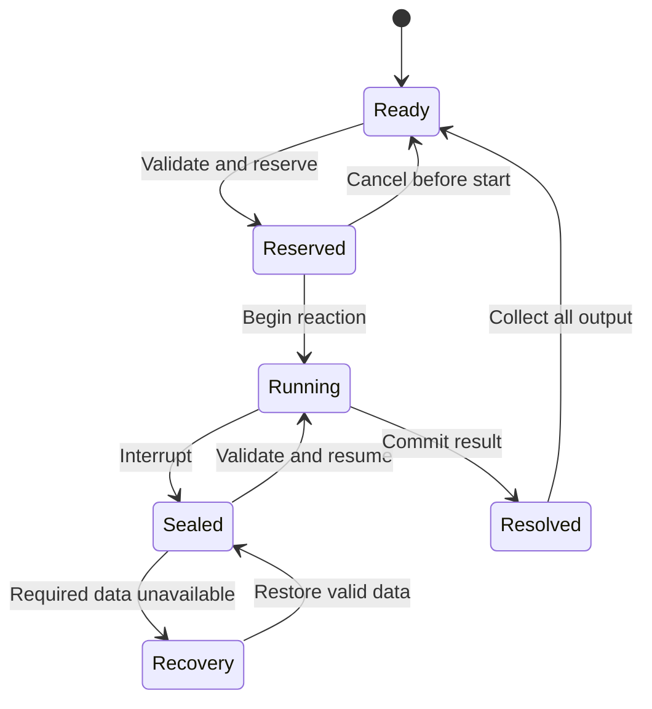

# Immersive Brewing — Development Specification and Coding-Agent Handoff

**Design version:** 1.0  
**Prepared:** 10 October 2026  
**Primary target:** Minecraft 1.20.1 · Forge 47.x · Java 17  
**Proposed identity:** `immersive_brewing` · `com.otectus.immersivebrewing` · `immersive-brewing`

> Build a believable alchemist’s workshop: prepare ingredients by feel, read the surface of a living brew, manage its reaction, and turn the result into useful, identifiable potions. The recipe determines the magic; the player’s craftsmanship determines the quality.

**Navigation:** [Source baseline and scope](#1-what-to-inherit-from-the-immersive-series) · [Stations and materials](#4-workstations-and-workshop-layout) · [Simulation and scoring](#8-simulation-and-scoring-contract) · [Potion semantics](#12-preserve-potion-semantics-end-to-end) · [Datapacks and API](#16-datapacks-and-public-extension-points) · [Persistence](#20-persistent-material-ownership-and-state-machine) · [Validation](#26-validation-plan) · [Implementation milestones](#27-implementation-milestones-and-dependency-order) · [Sources](#31-source-register-and-evidence-boundaries)

## 0. Instructions to the implementing agent

Use this document as a standalone product specification and engineering brief. Inspect the actual workspace and the four reference repositories before planning changes. Then produce a dependency-ordered implementation plan and carry it through to a playable, documented, tested v1.0. Use the acceptance criteria in this document as completion gates.

The new mechanics, numerical defaults, proposed class names, data formats, and milestones below are **design requirements**, not claims that Immersive Brewing already exists. The reference findings in section 1 and the source register in section 31 describe inspected source material. No game or build was run while preparing this specification.

First establish whether an Immersive Brewing project already exists. Preserve existing work and integrate from its actual state. Read applicable repository instructions. Record the branch, commit, Minecraft version, loader, Java version, build dependencies, and existing implementation before changing anything. If the project is already on another explicitly established target, document the discrepancy rather than silently downgrading it.

For a new project, use the verified family baseline: Minecraft 1.20.1, Forge **47.4.23**, Java **17**, ForgeGradle **6.0.54**, official mappings. This is a reproducible reference baseline, not a claim about the newest Forge release. Pin every optional test dependency to a verified compatible version.

Make routine implementation decisions independently. Record justified deviations in `docs/ARCHITECTURE.md`, including their effect on gameplay and compatibility. Keep the scope boundary explicit: all v1.0 requirements are expected; section 30 contains deliberately later features. Building the mod does not require rewriting the four sister mods or introducing a new mandatory shared library.

## 1. What to inherit from the Immersive series

The following default-branch snapshots were inspected. All four inspected `gradle.properties` files declare `mod_version=1.0.0`; this is source metadata, not a statement about published releases.

| Reference | Inspected commit | Observed pattern | Brewing application |
| --- | --- | --- | --- |
| [Immersive Smithing][smithing] | `0c5e781f53641a5cc9dcab72acde2a50e55a6fd3` | Physical forge/anvil/trough workflow; performance-based quality; discoverable recipes; maker attribution; server-scored sessions | A visible workshop, meaningful material transitions, bounded quality and brewer attribution |
| [Immersive Tanning][tanning] | `9101220cbf794c50a7f50c2d5e2a028198ffa2a3` | Distinct preparation and making interactions; passive work batched; material traits; readable station state | Separate reagent preparation from brewing; make passive handling convenient |
| [Immersive Enchanting][enchanting] | `035f25a4707d767594bc35cc105e997b44bb904c` | The original system chooses the result; an adapter snapshots its rules and costs; skill resolves the outcome | Preserve the actual brewing transformation and let skill modify only explicitly supported quality properties |
| [Immersive Jewelry][jewelry] | `c6294f0ea30d259d93c4d39a1936448eec353276` | Material-specific physical simulations; persistent escrow; optional Smithing integration; separate craftsmanship dimensions | Simulate pressure, heat and circulation; persist all material; isolate optional integrations |

Use the following source areas as architectural references:

- Smithing: `minigame/SessionTiming.java`, `workpiece/WorkpieceCodec.java`, `recipe/`, `quality/`, `docs/API.md`.
- Tanning: `blockentity/StationBlockEntity.java`, `minigame/`, `recipe/`, and the README’s batching, data and automation contracts.
- Enchanting: `api/EnchantingContextAdapter.java`, `session/`, `ritual/`, and its profile precedence and failure reporting.
- Jewelry: `docs/ARCHITECTURE.md`, `minigame/SessionManager.java`, `minigame/cutting/CutSimulation.java`, `minigame/StepClock.java` and `integration/smithing/SmithingIntegration.java`.

These are references to inspect, not a direction to copy entire systems. For example, Jewelry uses fixed 20 ms simulation steps; this specification proposes 50 ms brewing steps because brewing uses slower physical cues. Document that deliberate difference.

The existing projects include Stoneborn-style presentation. Brewing’s proposed default is a **vanilla-compatible pixel-art interface** with physical apparatus illustrations. A resource pack may supply an alternate family skin. No Stoneborn resource pack is required.

Preserve original notices and the projects’ declared GPL-3.0 licensing when reusing their code or assets. Track the origin and license of every borrowed asset.

## 2. Product pillars and release boundary

1. **Read the craft.** Foam, steam, particles, sediment and liquid motion explain what is happening.
2. **Make physical decisions.** Crushing, stirring, heating and collecting should feel different.
3. **Reward attention fairly.** A good run improves a bounded quality score. Rare catalysts, potion tiers and progression gates still matter.
4. **Respect time.** One meaningful brewing session serves a batch. Filling each bottle is not another minigame.
5. **Preserve material and identity.** Interrupted work survives. Existing potion IDs, effect rules and foreign item data remain authoritative.
6. **Work alone and in a pack.** The mod is complete by itself, with optional sister-mod, JEI and Jade integrations.
7. **Make failure instructive.** Explain what went wrong and offer a useful result or recovery route.

| Required for v1.0 | Explicitly later |
| --- | --- |
| Mortar preparation, Brewer’s Kettle, Alembic | Large-scale farming and new biome generation |
| Full supported vanilla brewing coverage and bounded batch production | Arbitrary player-created mixtures of unrelated potion effects |
| Distinct preparation, brewing and optional distillation games | Weapon coatings, alcohol, complex fermentation and spoilage |
| Quality, interrupted batches, brewer attribution and labels | NPC workers who play productive minigames |
| Recipe book, practice mode, JEI/Jade support | A mandatory character-level or research grind |
| Vanilla coexistence and safe covered-recipe replacement mode | Universal support for every custom machine or magic system |
| Datapacks, a small public API, diagnostics and multiplayer validation | Additional loader/version ports |

## 3. Intended player experience

A new player makes a stone mortar, experiments safely in practice mode, and collects familiar potion ingredients. After acquiring a brewing stand, she upgrades her workshop with a Brewer’s Kettle. She chooses three potions of Swiftness, sees the complete ingredient cost, optionally crushes the sugar for better extraction, and loads water bottles, nether wart, sugar and fuel.

The kettle comes alive. Gentle bubbles indicate the base is ready. Adding the sugar briefly cools the liquid and produces a pale foam. The player adjusts the draft, creates a controlled whirlpool, then eases off as the surface clears. The result is three potions with familiar effects, a visible quality grade, exact effective duration and the brewer’s name.

For the next batch, the player starts from stored Awkward Potions. The recipe planner charges only the remaining transformations. A six-bottle batch costs two normal three-bottle batches’ worth of reagents. It takes slightly longer to manage, but never requires six repetitions.

A poor batch remains usable at reduced quality. The player can accept it, or sacrifice part of it at an Alembic to purify the remainder. Unwanted compatible potions can instead become low-value spent salts for workshop supplies. Valuable original ingredients cannot be recovered through this route.

### Timing targets

| Activity | Target active time | Frequency |
| --- | --- | --- |
| Optional preparation | 10–16 seconds | Once per ingredient kit, not per bottle |
| Ordinary kettle brew | 28–40 seconds | Once per batch |
| Complex or six-bottle brew | 36–50 seconds | Once per batch; hard default cap 50 seconds |
| Modifier-only reaction on existing potions | 10–16 seconds | One short combined operation |
| Optional distillation | 14–22 seconds | Only when deliberately refining |
| Bottling and naming | Immediate inventory action | No dexterity check |

A typical first batch should take roughly 45–70 seconds of hands-on work including preparation and loading. Pre-staged repeat batches should be faster. Validate these targets with actual play; do not claim a timing target was met from simulation tests alone.

## 4. Workstations and workshop layout

All stations are single blocks with collision, selection and interaction shapes matching their visible geometry. Rotations must work consistently. Decorative neighboring blocks may be supported later; no fragile multiblock arrangement is required.

| Station | Appearance and physical state | Job |
| --- | --- | --- |
| **Apothecary’s Mortar** | Stone bowl on a small wooden base; visible reagent fragments; pestle moves during work | Prepare one recipe’s effect-reagent kit |
| **Brewer’s Kettle** | Iron vessel, copper rim, draft vent, visible liquid and bottle rack | Brew up to six servings through one controlled reaction |
| **Alembic** | Copper hood, glass receiver and cooling coil; visible condensate | Purify compatible potions or reclaim spent salts |

Proposed crafting recipes, using ordinary Minecraft items:

- Mortar: top row empty; middle row stone / empty / stone; bottom row plank / stone / plank.
- Kettle: copper / brewing stand / copper; brick / cauldron / brick; cobblestone across the bottom.
- Alembic: copper / glass bottle / copper; copper / bucket / copper; brick / iron ingot / brick.
- Wooden Brewing Paddle: two planks vertically above a stick.
- Iron Brewing Paddle: two iron nuggets vertically above a stick.
- Brewer’s Notebook: book plus glass bottle.
- Batch Carrier: glass bottle surrounded by four planks in the cardinal cells; empty carrier is reusable.

These are initial balance defaults. Use wood and stone tags where appropriate. Verify all ingredients exist on the target version and that the station progression has no cycle. The Kettle’s brewing-stand ingredient deliberately preserves the blaze-rod progression gate. Finding a brewing stand through normal play remains a valid way to progress. The bucket used in the Alembic recipe is a structural component and is consumed there; declare that behavior explicitly in its recipe.

The Mortar includes its pestle; require no extra tool for this game. The Kettle requires a paddle. The Alembic has built-in valves. An iron paddle lasts longer than a wooden one but grants no automatic quality bonus.

### Visible and inspectable state

Render loaded ingredients, fill level, heating, foam, settled liquid, finished bottles and Alembic condensate from server-confirmed state. Another player should understand what a station is doing without opening it.

Provide a concise status on interaction and through Jade:

- “3 water bottles · Ready to load nether wart”
- “Infusing · Gentle simmer · Stir clockwise”
- “Sealed batch · Resume brewing”
- “Finished · 3 Fine Potions of Swiftness”
- “Output rack full”

Use distinct icons and text as well as color. World effects follow validated state; particles never decide progress.

## 5. Inventory, liquid and batch accounting

### 5.1 Authoritative batch model

Represent a batch as a bounded collection of **actual input and planned output ItemStacks**, not as an untyped tank of magical fluid. The kettle’s visible liquid is a rendering of these contents.

For v1.0:

- A batch contains 1–6 servings.
- All servings share the same canonical input identity, selected transformation path and relevant foreign data. Display names may differ only if the output mapping preserves each separately.
- Mixed potion types or incompatible custom payloads are refused with a clear explanation; the ordinary brewing stand remains available.
- Each serving begins as one real water bottle or compatible potion container. Internal stack counts must respect the item’s legal maximum.
- Bulk inventory insertion may distribute a stack into individual servings; a larger-stack mod must not change reagent economics.
- Bottling transforms the already supplied containers. It consumes no second set of bottles and creates no spare empties.
- A batch with three water bottles finishes as three potion containers. Additional bottles cannot multiply a finished batch.
- A carrier stores exact bottle stacks and remaining capacity. It is transport storage, not a drinkable multi-dose item.

This deliberately postpones arbitrary potion fluids. Optional water-fluid insertion may fill **empty glass bottles** in the idle kettle. Use an explicit documented conversion of 250 mB water per bottle; one 1000 mB bucket fills four bottles and returns the bucket. Water bottles obtained from ordinary water sources still work. Filled potions cannot be exported as generic fluids in v1.0.

### 5.2 Reagent and fuel conservation

For standard brewing transformations with one reagent per group of up to three bottles:

`reagent_cost_per_step = ceil(servings / 3) × source_step_cost`

A custom adapter must declare its real batching semantics; do not assume every mod follows vanilla.

Examples:

| Plan | Servings | Required reagents |
| --- | --- | --- |
| Water → Awkward → Swiftness | 3 | 1 nether wart + 1 sugar |
| Water → Awkward → Swiftness | 6 | 2 nether wart + 2 sugar |
| Awkward → Swiftness | 3 | 1 sugar |
| Swiftness → a valid extended variant | 3 | 1 redstone, if the source recipe accepts it |
| Drinking → splash → lingering | 3 | 1 gunpowder + 1 dragon’s breath, plus their actual remainders |

Use a persistent fuel-charge ledger. Initial default: blaze powder provides 20 charge units, and each normal three-bottle reagent application costs one. A six-bottle application costs two. Verify this reference value against the pinned development environment. A multi-step brew charges every planned step even though its actions are presented as one session.

The Kettle has an enclosed blaze-heated burner: fuel drives its visual flame and the paddle/draft controls regulate it. Do not also require coal or a neighboring fire in the default mode. Otherwise the replacement would silently impose a second fuel economy.

Fuel, catalysts and crafting remainders have independent accounting. A blaze powder used as the Strength reagent is not also fuel. Dragon’s breath must return its correct container exactly once.

### 5.3 Capacity and output

Provide separate ingredient, paddle, fuel and bottle areas. Reserve output capacity before starting. Once work is committed, its output is held safely in the station even if a menu closes. Automation and other players cannot take reserved stacks.

Use a bounded completed-output buffer rather than dropping excess output into the world. All inventory actions—including shift-click, drag, hotbar swap and capability access—must enforce the same reservation rules.

## 6. Core game A — “Open the Ingredient”

**Fantasy:** The brewer releases useful material without pulverizing everything into worthless dust.

The preparation game operates on the **effect-bearing reagent kit for the selected brew**. Base catalysts and modifiers such as nether wart, redstone, gunpowder and dragon’s breath normally need no preparation. This keeps a long recipe from becoming six repeated grinding games.

### Interaction

1. Show the actual ingredient fragments in the bowl and a pictorial endpoint: cracked, bruised, ground or emulsified.
2. Move the pestle through the bowl while holding the primary action. A keyboard alternative moves or rotates it through the same simulation.
3. Pressure builds while pressing. Releasing relaxes the pestle.
4. Coarse fragments break down at different rates. High pressure is useful initially; finishing requires lighter work.
5. Lift and fold once or twice when the batch clumps, then stop when the material has the indicated texture.

Control and sound should explain the process: coarse crunches become a soft granular scrape; leaves darken and bruise; an emulsion becomes uniform. Overworking clouds the bowl and produces a visible dust or oil-separation warning. Essential cues also appear as text and shapes.

### Material profiles

| Profile | Typical input | Distinct behavior |
| --- | --- | --- |
| Crystalline | Sugar and explicitly profiled crystalline reagents | Crack coarse pieces, then stop before excessive fines |
| Fibrous | Explicitly profiled plant reagents | Gentle circular pressure; folds expose unworked fibers |
| Soft/organic | Spider eyes or other supported soft reagents | Low pressure; uniform mashing matters more than speed |
| Brittle/mineral | Explicitly profiled solid reagents | Short controlled presses; excess force creates fines |
| Liquid/resin | An adapter-declared liquid reagent | Fold and emulsify; no pretend rock-crushing animation |
| Unprofiled | Any accepted effect reagent without a safe material profile | Skip preparation and use baseline extraction |

The material selector is a datapack rule. Never infer an item’s chemistry from its translated name.

### Scoring and material behavior

Use `Extraction`, `E`, from 0–100:

`E = round(100 × (0.70 × endpoint_accuracy + 0.30 × restraint))`

- `endpoint_accuracy` measures how much of the batch reaches its requested particle or emulsion window.
- `restraint` measures time spent avoiding overpressure and unnecessary work after the endpoint.
- Both terms are clamped to 0–1.
- Rate-limit effective motion and work per simulation step. High DPI, event spam and very fast circles must not produce more extraction.
- With no productive input, the score is zero.
- A deadline resolves the current state; it does not erase the ingredient.
- Raw, unprepared effect reagents are always usable with `E=50`.
- Tool quality changes durability or clarity of cues, not the final score.

Store a prepared kit as one data-bearing item containing the exact consumed source reagent stacks, serving-group count, preparation profile, fixed extraction score and schema version. It is an accounted transformation of those reagents, not an additional ingredient. It cannot be unpacked into raw reagents after preparation begins, re-ground for a fresh roll, or substituted for extra servings.

Only explicitly profiled ingredients may enter kits. Reject arbitrary container items with nested inventories or unknown stateful behavior. Bound embedded data size and nesting. Prepared kits with identical relevant data may stack if their consumption remains exact; do not create one registered item per ingredient/grade combination.

Bulk preparation may process at most four identical recipe kits in one session, consuming four times the sources. It should add a modest time increment, not multiply output for free. All kits receive the same earned result.

## 7. Core game B — “Tend the Living Brew”

**Fantasy:** The brewer reads the brew and nudges it through a reaction.

Use one evolving simulation, with **Bloom → Infuse → Settle** phases. The player manages heat and circulation, then makes a small number of deliberate additions. Avoid separate unrelated overlays for each ingredient.

### Controls

- Set the burner draft to **Low / Medium / High** with three visible buttons or remappable keys.
- Stir clockwise or counterclockwise by holding a direction control. Releasing lets the liquid coast.
- Optionally allow mouse circles over the liquid; convert them into the same capped stir command as keyboard input.
- Press the addition control to tip in the next already-reserved ingredient when its material cue appears.
- A dosing prompt temporarily suspends the need to issue a new stirring command. At most two simultaneous control concerns are active.
- The brewing screen captures these actions and prevents movement/attack bindings from also firing.
- Every addition displays its item, stage and generous cue before the scoring interval opens.

Do not demand an exact real-world circular motion, repeated clicking, rapid alternating taps or memorized ingredient sequences. The recipe is visible throughout.

### Phase 1: Bloom

Bring the base to a gentle, stable simmer. Heat has inertia: high draft accelerates warming but can overshoot. A proper bloom has small evenly spaced bubbles. Large bursts mean excessive heat; a still surface means insufficient heat.

Add the base catalyst, if required by the chosen path. Existing Awkward Potions shorten or omit this phase.

### Phase 2: Infuse

The effect reagent changes the liquid’s behavior. Each profile has a predictable reaction signature:

- **Swiftness:** light foam expands under excessive agitation; steady moderate circulation disperses it.
- **Strength:** dense red sediment settles; brief stronger stirring lifts it, followed by gentle circulation.
- **Healing/Regeneration:** a delicate surface shimmer breaks at high heat; lower heat and patient folding preserve it.
- **Fire Resistance:** thick magma streaks need sustained circulation, then reduced heat.
- **Water Breathing:** suspended bubbles gather; reverse direction once at a clearly announced stage to release them.
- **Poison/Weakness/Harming:** dark whorls drift from the ingredient; controlled addition and a brief quiet rest clarify the result.
- **Night Vision/Invisibility:** suspended glints align as the brew settles; vigorous late stirring disrupts them.
- **Slow Falling/Leaping:** light particles float; gentle downward circulation incorporates them.

These are visual and simulation profiles for existing potion paths. They do not imply real-world chemistry or add effect combinations.

### Phase 3: Settle

Ease the heat, reduce circulation and finish the reaction. The liquid becomes clear or evenly suspended according to its profile. If the plan contains redstone, glowstone or container modifiers, the phase presents a small number of combined, well-telegraphed dosing actions. Their recipe costs and order remain exact.

A modifier-only session starts from the appropriate reaction phase and lasts 10–16 seconds. It does not replay a complete brew.

### Disturbances and readable challenge

Generate a small seeded schedule at start: an ingredient cools the liquid, a sediment pocket forms, or foam rises. Every disturbance has a visual warning and sufficient lead time. It must be possible to score highly with all valid generated schedules.

Basic recipes contain 2–3 interventions. Complex recipes contain 4–5. Skill comes from anticipating inertia and reading changes, not from increasingly narrow reaction windows. Default addition windows are at least 700 ms wide; no required release depends on a single frame.

## 8. Simulation and scoring contract

Keep the simulation in pure Java, independent of Minecraft rendering, screens, inventories and networking. Provide deterministic inputs, fixed parameters, a seed, state snapshots and a resolved score.

### 8.1 Kettle state

At minimum track:

- Phase and phase-local elapsed steps.
- Normalized heat `H` in 0–1.
- Signed circulation `V` in −1–1.
- Foam, sediment and clarity in 0–1.
- Scheduled additions and whether each was made early, on time, late or automatically.
- Integrated thermal and circulation error.
- Participation, disturbance state and completion state.

Initial tuning model, with `dt=0.05 seconds`:

`H_next = clamp(H + heat_response × (draft_target − H) × dt − addition_cooling, 0, 1)`

`V_next = clamp(V + stir_response × (stir_command − V) × dt, −1, 1)`

Draft targets initially map Low/Medium/High to 0.30/0.55/0.82. Recipe profiles define valid bands and response constants. Stir commands are capped; stopping the input decays circulation smoothly.

Foam rises from excessive heat/agitation when the profile supports foam. Sediment rises when circulation is insufficient. These variables produce visual feedback and affect the corresponding control score; they must not add the same error penalty twice.

Use continuous error scoring with a full-credit band and gradual falloff. A tiny excursion must not turn a good batch into a failed batch. Normalize each phase by its actual scoring duration; omitted base phases contribute no imaginary points.

### 8.2 Brewing score

`C = round(100 × (0.40 × thermal_control + 0.35 × circulation_control + 0.25 × dosing_control))`

Each term is 0–1. Missing additions receive zero dosing credit. To keep the selected recipe valid, the apparatus makes a missed reserved addition at the end of its phase, with a clearly reported late-addition penalty. It never adds a different ingredient or refunds a reagent already used.

A fully inactive session resolves with `C=0`. Low activity must not be accidentally rewarded because a default heat setting happens to fit one phase. Ordinary holding and accessibility controls count as legitimate participation; do not require arbitrary action counts.

Overall quality:

`Q = round(0.25 × E + 0.75 × C)`

Use `E=50` when preparation is skipped or inapplicable. Example: `E=80` and `C=84` produce `Q=83`. A raw-ingredient brew with `C=100` reaches `Q=88`, so the highest grade rewards both crafts.

### 8.3 Difficulty

Calculate a bounded complexity profile from the **selected valid transformation path**, serving count and explicit reagent profiles. Suggested tiers:

| Tier | Examples | Duration | Challenge |
| --- | --- | --- | --- |
| Gentle | Base brews, ordinary one-effect potions | 28–32 s | Broad bands; two interventions |
| Practiced | Extended/strong variants, moderate volatile profile | 32–40 s | One thermal disturbance and one circulation change |
| Intricate | Valid multi-step corruptions or lingering plans | 38–46 s | Four or five telegraphed interventions |
| Large batch | 4–6 servings | Add up to 4 s | More inertia; no duplicate minigame |

Cap the final duration at 50 seconds and simultaneous demands at two. Harder recipes should remain readable with reduced particles, disabled sound and a colorblind palette.

The seed varies disturbances within validated bounds. It never changes ingredient costs, requested effects, quality formulas or hidden success chances.

## 9. Optional game C — “Catch the Heart”

The Alembic is a deliberate recovery and refinement activity. It is not a mandatory final station for every potion.

### 9.1 Purification

Accept groups of three compatible, unrefined potions of the same canonical contents and quality. Consume three and return **two** of that same potion with improved, capped craftsmanship. Support two groups at once.

The player controls the heat valve and coolant valve while watching the receiver:

1. Early cloudy condensate goes into the waste channel.
2. A clear, symbol-marked central collection interval appears.
3. The player switches the receiver to collect this interval.
4. Rising haze indicates the tail; switch back before it contaminates the collected portion.

Use broad, predictable transitions, with condensation rate and receiver markings as cues. This is a routing/control game, not another timing ring.

Distillation score:

`D = round(100 × (0.50 × collection_accuracy + 0.30 × thermal_control + 0.20 × cooling_control))`

For a completed purification with `D >= 35`:

`Q_out = max(Q_in, min(70, round(50 + 0.20 × D)))`

For `D < 35`, keep `Q_out=Q_in`. The two output potions remain usable. Explain the yield loss and lack of improvement.

Rules:

- Reject purification when `Q_in >= 70`.
- Each lineage may be purified once. A modifier, relabel, carrier or recipe conversion must not reset this flag.
- The operation costs one blaze-fuel charge per three input potions.
- The sacrificed potion returns its empty container; the two survivors retain their containers.
- Preserve the potion effect, amplifier, canonical variant, foreign data that the adapter supports, and original brewer attribution. Add “Refined by” separately.
- Use the immutable canonical effect duration when resolving the new quality. Never multiply an already increased duration.
- Any already capped or foreign contents the adapter cannot faithfully reconstruct are ineligible.
- A failed session never substitutes a harmful effect, explodes, damages nearby players or breaks the station.

This creates a useful trade: rescue an imperfect batch at a real quantity cost. It cannot manufacture Masterwork potions or recover rare reagents.

### 9.2 Reclamation

A second Alembic operation reclaims compatible unwanted potion contents:

- Three accepted potions → one **Spent Alchemical Salt** plus their three empty containers.
- One fuel charge per group.
- Passive 10-second processing; no repeated skill game is needed for low-value waste handling.
- No nether wart, blaze powder, dragon’s breath, turtle shell or effect reagent is returned.
- Custom containers and unknown modded payloads require an explicit adapter.
- A bundled low-value use is one spent salt plus one ink sac → two gray dye. Do not add valuable villager buy trades or experience for repeated reclamation.

Purification changes quality; reclamation produces a modest by-product. Keep their input rules and previews visibly separate.

## 10. Bottling, carriers, labels and the notebook

### Bottling

The kettle’s bottle rack fills in one completion animation. The server has already produced the output stacks; the animation is presentation. Taking one bottle reduces the stored quantity by exactly one. Shift-click and hopper extraction behave consistently.

There is no pouring minigame. Precision bottling would add a third compulsory dexterity check without a distinct enough decision.

### Batch Carrier

A reusable carrier holds up to six potion-container stacks. Loading and unloading transfers exact stacks, including foreign tags and brewing data. A carrier has no potion effect of its own and cannot enter a brewing recipe. Its preview shows each contained potion, quantity and grade.

Provide a narrow item-handler implementation if automation support is enabled. Prevent nested carriers, recovery batches or other inventory-bearing items. Validate capacity on load and preserve excess recoverably rather than silently deleting it.

### Brewer attribution and naming

Record the creating player UUID, display-name snapshot and an optional short label. Avoid storing chat history or unnecessary timestamps. Attribution is provenance, not an ownership lock. Include a compact lineage token for a finished batch and propagate it through supported transformations; keep the full processing history in the job ledger rather than every bottle.

- Label maximum: 48 Unicode code points.
- Optional note maximum: 120 code points.
- Server validates length and control characters.
- Player labels are literal text, not executable JSON components or clickable commands.
- Labels never affect recipe identity, ingredient cost, quality or potion power.
- Removing or changing a label preserves the underlying result and attribution.
- The base potion name remains available in the tooltip and recipe search.

Default tooltip, illustrative rather than a hardcoded recipe result:

```text
Fine Potion of Swiftness
Speed — [effective duration]
Extraction: 80 · Brewing: 84
Brewed by Jade
“Roadwalker’s Reserve”
```

Use the actual player name; “Jade” above is only an example.

### Brewer’s Notebook

A built-in guide works without Patchouli:

- Getting started, station recipes, controls, quality and recovery.
- A searchable list of supported known brewing paths.
- Exact ingredients, fuel charges and container returns.
- Reagent preparation hints and reaction signatures.
- Favorite plans and preferred batch size.
- Last-result explanation: heat, circulation, additions and a concrete improvement tip.
- A clear distinction between “supported here,” “works in the normal brewing stand,” and “requires an adapter.”
- Links to free practice sessions.

Vanilla recipes are available from the start. The notebook is not a mandatory research gate. Preferences are player data with bounded storage; they must not embed unbounded item histories.

## 11. Quality and the potion power budget

### 11.1 Grades

Reuse the familiar Smithing/Tanning grade thresholds:

| Score | Grade |
| --- | --- |
| 0–34 | Crude |
| 35–69 | Standard |
| 70–89 | Fine |
| 90–100 | Masterwork |

Grade is a summary of craftsmanship, not an additional multiplier.

### 11.2 Default mechanical benefits

Use small continuous changes:

`duration_multiplier = 0.80 + 0.004 × Q`

This gives 0.80× at quality 0, exactly 1.00× at 50, and 1.20× at 100.

Apply it only to finite-duration effects explicitly accepted by the effect policy. Preserve amplifier, ambient state, visibility flags and the native variant selected by the actual recipe. Standard at score 50 must match the source recipe exactly.

Never turn an ordinary potion into its stronger or extended registered variant just because its grade is high. Redstone and glowstone retain their own recipe roles and incompatibilities.

Default drinking time for supported vanilla drinkable potions:

`use_ticks = round(36 − 0.08 × Q)`

This is 36 ticks at quality 0, vanilla-like 32 at 50, and 28 at 100. It affects drinking only, not thrown-projectile cooldowns. Verify the actual vanilla use duration in the pinned environment and adjust the baseline if necessary.

### 11.3 Effects needing special treatment

| Contents | Default treatment |
| --- | --- |
| Ordinary finite beneficial or harmful effects | Bounded duration scaling if explicitly allowed |
| Instant Health and Instant Damage | Preserve the exact native magnitude and amplifier; drinking-time benefit may apply |
| Mixed beneficial/harmful effects, including Turtle Master | Preserve the bundle; use an explicit bundle policy, initially metadata and drinking-time only |
| Infinite-duration effects or invalid duration sentinels | Preserve unchanged |
| Unknown modded effects | Metadata only until an effect policy or adapter declares duration scaling safe |
| Unknown custom potion items | Exact-output pass-through where possible; no guessed use-time or effect hooks |
| Base water, Awkward, Mundane and Thick potions | No duration benefit; no finished-potion quality cap imposed on later effect creation |

A Masterwork splash potion of instant damage has no automatic damage bonus. Prestige can remain meaningful without multiplying every effect’s power.

Quality never increases bottle count. There is no independent purity roll, random critical brew, hidden healing multiplier or generic amplifier increase.

### 11.4 Failure policy

Default mistakes reduce quality. A completed valid recipe still produces its intended potion with the bounded penalties above.

Interruption produces a resumable batch, not a completed reward. Destructive failure is out of scope for v1.0. The result screen explains the actual score contributors; it must not blame “bad luck.”

## 12. Preserve potion semantics end to end

This is a release-blocking engineering requirement.

### 12.1 Canonical versus effective contents

Maintain a distinction between:

1. **Canonical contents:** the exact item, potion identity, effects, custom data and container returned by the authoritative brewing operation.
2. **Brewing metadata:** extraction, control score, effective quality, provenance, purification flag and schema version.
3. **Effective contents:** a fresh resolved view that applies only the permitted bounded changes.

Keep the canonical potion identity intact. Do not replace all outputs with a generic custom potion item. Do not store a second copy of a base effect in `CustomPotionEffects` merely to change its duration: that can create duplicate or conflicting effects.

Build a single `PotionContentsService` that resolves effective contents from canonical contents and brewing metadata without mutating either. It must be idempotent:

`resolve(stack) == resolve(stack)`

Repeated reads, saving/loading or converting the container must not apply the multiplier again.

### 12.2 Required application paths

Inspect the exact Minecraft 1.20.1 code and Forge patches before choosing hooks. A tooltip-only change is not implementation.

| Path | Required behavior |
| --- | --- |
| Drinking | Effective duration and use time are actually applied; normal container remainder retained |
| Splash impact | Correct effective effects with normal vanilla distance attenuation; instant effects applied once |
| Lingering cloud | Carry the resolved contents into the cloud; apply vanilla cloud duration/radius rules exactly once |
| Tipped-arrow crafting | Preserve canonical identity and relevant brewing metadata through the recipe |
| Arrow impact | Apply effective contents with the native arrow duration conversion once |
| Dispensers | Same contents and application behavior as player-thrown bottles |
| Rebrewing and modifiers | Use canonical contents for transformation; preserve or conservatively resolve quality |
| Tooltip, inventory tint and JEI | Describe the same result that actual consumption produces |

For vanilla stacks, narrowly scoped hooks may be necessary around effect extraction, projectile/cloud initialization, arrow crafting and use duration. Restrict them to tagged stacks/entities. Use fresh effect objects; do not mutate registry potion instances or shared effect lists.

A cloud or projectile may store a resolved effect list internally where its API requires it, but must not also retain a second active base list. Test instant effects and lingering clouds specifically for double application.

Preserve the normal rules for undead targets, effect replacement, immunity, armor, source attribution, splash attenuation and projectile ownership. Brewing does not implement its own damage system.

For foreign items, an adapter declares the contents and application paths it can preserve. If it cannot guarantee round-trip correctness, use metadata-only quality or leave the operation in its original system. A specific unsupported item is preferable to silently damaging its contents.

### 12.3 Quality inheritance

- Creating the first effect from water or a base potion earns the new `Q` normally.
- Ordinary vanilla inputs without brewing metadata are baseline, not invalid legacy items.
- Modifier-only operations on an already graded potion cannot improve its quality.
- For such an operation, preserve extraction and compute a candidate from its new control score; `Q_out = min(Q_in, candidate_Q)`.
- A container-only passive conversion outside this mod preserves quality when the conversion is positively identified; it grants no new score.
- A vanilla pass-through result with no supported preservation path remains usable, with a documented metadata-only or ordinary-output fallback.
- New effect creation from an existing graded effect, such as supported corruption, also cannot exceed the input’s grade score.
- Purification is the only v1.0 operation allowed to raise a finished potion’s score, and has the one-time/yield limits in section 9.
- All transformations retain the purification flag and lineage.
- A complete planned brew computes quality once at its end. It does not multiply quality for every internal reagent step.

Canonical fingerprinting must ignore this mod’s cosmetic labels and bookkeeping while respecting relevant foreign tags and capabilities. Avoid using mutable display text as a recipe key.

## 13. Vanilla recipe coverage and progression

The recipe system must account for actual registered transformations. The following is a coverage checklist, not a substitute for reading the pinned registry.

| Family | Familiar effect reagent or path to cover |
| --- | --- |
| Base brews | Water; nether wart; registered Mundane/Thick outcomes |
| Swiftness | Sugar |
| Leaping | Rabbit’s foot |
| Strength | Blaze powder |
| Healing | Glistering melon slice |
| Harming | Valid fermented-spider-eye corruptions |
| Poison | Spider eye |
| Regeneration | Ghast tear |
| Fire Resistance | Magma cream |
| Water Breathing | Pufferfish |
| Night Vision | Golden carrot |
| Invisibility | Valid corruption of Night Vision |
| Slowness | Valid corruptions of eligible movement potions |
| Weakness | The valid water-bottle/fermented-spider-eye route, including its exception to nether wart |
| Slow Falling | Phantom membrane |
| Turtle Master | Turtle shell, with its complete native effect bundle |
| Modifiers | Only valid redstone/glowstone variants and corruption orderings |
| Containers | Drinking → splash using gunpowder; splash → lingering using dragon’s breath |
| Arrows | Native tipped-arrow crafting and retained contents |

The mod must not invent survival recipes for Luck, arbitrary command-only potions, incompatible strong-plus-long combinations or new effect combinations. A datapack may explicitly introduce a new recipe under its own rules.

Retain the actual cost of expensive reagents and all crafting remainders. A turtle shell is a real consumed input when the source recipe says so.

Starting from an intermediate potion must charge only the remaining path. The plan preview shows every step and allows a player to choose among supported alternatives; do not silently choose a path that spends a rare ingredient when a different available path was expected.

## 14. Relationship with the ordinary brewing stand

Ship three clearly named server modes:

| Mode | Behavior |
| --- | --- |
| `COEXIST` — default | Existing stands and recipes keep working. The Kettle offers the hands-on, graded batch route. |
| `REPLACE_COVERED` | Covered effect-creation transformations are routed through the Kettle; unsupported operations remain available normally. |
| `DISABLED` | New productive jobs and brewing-stand interception stop. Existing jobs may still resume or recover, and previously brewed potions retain their supported contents behavior. |

Coexistence is a deliberate default for this new mod. It makes the first release safe to add to an existing pack while still giving handmade brewing a bounded benefit. Pack authors can select the more comprehensive workshop progression.

In `REPLACE_COVERED`:

1. Build a coverage set only from validated transformations with a working alternative.
2. Guard before a vanilla stand starts consuming fuel or its timer. Cancelling only `PotionBrewEvent.Pre` is insufficient because it occurs at the brew-completion boundary.
3. Explain the blocked operation in the UI and Jade.
4. Preserve modifier/container conversions by default; allow a separate `replaceModifiers` option for packs that want these at the Kettle too.
5. Keep the brewing stand craftable and obtainable; it is part of Kettle progression.
6. Leave unrelated mods’ machines alone unless an explicit machine adapter owns them.
7. For mixed-slot cycles containing an unsupported transformation, pass the whole cycle through by default. Report this conservative exception; it may also let covered bottles finish at ordinary quality.
8. Never remove a source operation if its Kettle alternative is missing, invalid, gated behind itself or excluded by configuration.

Do not require source recipe deletion from a generic RecipeManager: Forge brewing registrations are not simply ordinary crafting recipes. Do not globally block every item with a potion tag.

## 15. Brewing adapters and discovery

### 15.1 Verified Forge starting point

The inspected Forge **1.20.1** sources expose:

- `BrewingRecipeRegistry.getOutput(input, ingredient)`
- `getRecipes()`, `isValidInput` and `isValidIngredient`
- `IBrewingRecipe` predicates and output calculation
- A `VanillaBrewingRecipe` delegating to vanilla potion mixing
- `PotionBrewEvent.Pre/Post` and brewing-stand patches using the registry

Use the **1.20.1** branch or pinned source JAR. Forge’s broader `1.20.x` branch contains different brewing code and is not an interchangeable reference.

The registry can query outputs, but arbitrary `IBrewingRecipe` implementations do not necessarily expose a complete enumerable list of inputs and outputs. Therefore “registered potion” does not automatically mean “every recipe can be discovered.”

### 15.2 Adapter contract

Proposed `BrewingAdapter` responsibilities:

- `id`, priority and cheap applicability check.
- `preview`: pure query returning exact canonical outputs and true costs, or an unsupported reason.
- `validateStart`: check actual source stacks and conditions.
- `fingerprint`: include all recipe-relevant state.
- `batchPolicy`: declare per-reagent costs, serving limits, remainders and whether identical servings can share a reaction.
- `contentsPolicy`: declare metadata-only or specific effect/use-time support.
- `commit`: perform the validated operation exactly once.
- `preserveTransformation`: handle recognized external modifier/container conversions where available.

All mutable work runs on the server thread. Preview must operate on safe copies and must not consume, reroll or mutate live inventories. An adapter that cannot provide a stable preview/commit contract cannot support a queued multi-step plan.

Resolve adapters deterministically by explicit priority and ID. Log ownership conflicts. An explicit recipe override may choose an adapter; do not invoke several adapters on the same result.

### 15.3 Discovery strategy

1. Ship a verified vanilla recipe index and check it against runtime mixing.
2. Support finite Forge recipes where their public data permits enumeration.
3. Support actual input-plus-ingredient queries for opaque recipes.
4. Accept explicit datapack plans for additional safe combinations.
5. Use dedicated adapters for machines or recipes with extra context.

Bound automatic exploration: maximum eight steps per plan, six servings, cycle detection and a configurable finite candidate-pair budget. Start with 4096 indexed pairs per discovery rebuild; cache results by registry/data generation and recipe-relevant fingerprints.

Never brute-force every item’s arbitrary NBT combinations. Cache invalid results briefly, and do not run full discovery each tick or on every tooltip. A valid opaque query can appear as a contextual option even if it cannot appear in the global recipe catalog.

Treat modded output stacks as authoritative. Keep their custom effects, colors, containers, names and payloads unless that transformation intentionally changes them. Do not reconstruct them from a potion registry ID alone.

## 16. Datapacks and public extension points

All proposed formats below are part of the v1.0 implementation contract. They must ship with schemas or equally precise field documentation and executable example tests. They are not existing Forge formats.

### 16.1 Resource layout

| Resource | Path under `data/<namespace>/` | Purpose |
| --- | --- | --- |
| Explicit infusion plan | `recipes/<path>.json`, type `immersive_brewing:infusion` | Declares a supported sequence of authoritative transformations |
| Distillation recipe | `recipes/<path>.json`, type `immersive_brewing:distillation` | Declares an explicitly supported refinement policy |
| Reclamation recipe | `recipes/<path>.json`, type `immersive_brewing:reclamation` | Declares safe salvage inputs and fixed outputs |
| Reagent profile | `immersive_brewing/reagent_profiles/<path>.json` | Preparation behavior and reaction signature |
| Brew profile | `immersive_brewing/brew_profiles/<path>.json` | Simulation phases, bands, disturbances and timing |
| Effect policy | `immersive_brewing/effect_policies/<path>.json` | Explicitly allowed quality treatment |
| Tags | Standard `tags/items/` and `tags/blocks/` | Materials, exclusions, paddles and accepted optional content |

Resource IDs follow normal namespace/path rules. A file under another mod’s namespace is valid. Store quality as data, not as a separate recipe/item ID for every grade.

### 16.2 Example explicit vanilla plan

```json
{
  "type": "immersive_brewing:infusion",
  "schema_version": 1,
  "adapter": "immersive_brewing:forge_registry",
  "input": {
    "item": "minecraft:potion",
    "potion": "minecraft:water",
    "match": "canonical"
  },
  "steps": [
    {
      "reagent": { "item": "minecraft:nether_wart" },
      "phase": "bloom"
    },
    {
      "reagent": { "item": "minecraft:sugar" },
      "phase": "infuse",
      "preparation_profile": "immersive_brewing:sugar"
    }
  ],
  "expected_output": {
    "item": "minecraft:potion",
    "potion": "minecraft:swiftness"
  },
  "batch": {
    "max_servings": 6,
    "servings_per_reagent": 3
  },
  "brew_profile": "immersive_brewing:light_foam"
}
```

Required semantics:

- `expected_output` validates the delegated result; it does not manufacture that result.
- Resolve and validate each step against the adapter.
- Copy the actual delegated output stack, preserving its supported data.
- Reject a plan if the result differs, an input is ambiguous, or an intervening step is invalid.
- The vanilla adapter verifies the specified batching rule. A datapack cannot claim six servings per reagent to bypass its declared costs.
- Derive intermediate entry points only where the sequence can be safely split. Entering from Awkward removes the nether-wart cost.
- A new explicitly custom recipe may use a separate fixed-output adapter, with its complete costs and policy stated. Keep that capability distinct from delegated vanilla recipes.
- Generic Forge recipes without stable resource IDs need a stable adapter-owned key; do not invent a vanilla recipe-manager ID for them.

### 16.3 Example reagent profile

```json
{
  "schema_version": 1,
  "priority": 100,
  "selector": {
    "items": ["minecraft:sugar"]
  },
  "preparation": {
    "mode": "crystalline",
    "duration_ticks": 240,
    "endpoint": [0.60, 0.78],
    "pressure_limit": 0.70,
    "overwork_threshold": 0.86
  },
  "reaction": {
    "profile": "immersive_brewing:light_foam",
    "addition_cooling": 0.08,
    "foam_sensitivity": 0.65
  }
}
```

Preparation state is normalized 0–1. The endpoint interval is the desired processed fraction; overwork begins above its explicit threshold. All numeric values must be finite and bounded. Use server data for scoring and presentation data for texture/sound choices.

Selectors may specify exact item IDs, tags, namespaces and exact recipe IDs. Criteria within a selector combine with AND; entries within a list combine with OR. Empty selectors match nothing.

### 16.4 Example effect policy

```json
{
  "schema_version": 1,
  "priority": 100,
  "effects": ["minecraft:speed"],
  "quality_mode": "duration",
  "minimum_multiplier": 0.80,
  "maximum_multiplier": 1.20,
  "allow_amplifier_change": false,
  "allow_infinite_duration_change": false
}
```

The server’s global caps are applied last and can narrow a datapack’s values. V1.0 rejects `allow_amplifier_change=true` rather than pretending the implementation supports it. Documentation must label accepted, reserved and rejected fields accurately.

### 16.5 Profile resolution

Choose a complete profile deterministically; avoid a difficult-to-debug partial merge:

1. An explicit profile named by a valid recipe.
2. Matching exact recipe selectors.
3. Matching exact item selectors.
4. Matching item-tag selectors.
5. Matching namespace selectors.
6. Built-in safe fallback.

Within one layer, highest priority wins; equal priority uses a documented lexicographic ID tiebreak and produces a diagnostic. Normal datapack resource priority still determines which definition exists for a duplicated resource ID.

Provide exclusions for items, recipes, effect policies and whole adapter IDs. A broad namespace rule must not bypass an explicit exclusion.

### 16.6 Reload behavior

Parse into an immutable candidate dataset; validate references, cycles, ranges, capacity, output semantics and maximum sizes before activating it.

- An invalid brewing dataset retains the previous active brewing dataset and prints actionable resource IDs and fields.
- An optional-mod condition that evaluates false is a normal skip, not an error.
- On initial load with no previous dataset, invalid optional content is disabled and the safe built-in core remains usable; report the incomplete coverage.
- Cancel uncommitted previews on reload.
- Seal active committed jobs with their immutable old parameters and canonical output snapshots.
- Resume such jobs under that snapshot if all required item/effect types and adapter contracts remain available. Otherwise hold them for recovery with an explicit reason.
- Sync the activated generation to clients and invalidate recipe/JEI/Jade caches.
- If a source adapter’s live registry changed, require revalidation before a new job starts. Do not silently swap the path of an already committed job.

### 16.7 Public API

Expose a small versioned API rather than all internal classes:

- Register a `BrewingAdapter`.
- Register an effect-quality handler with explicit supported application paths.
- Query immutable brewing metadata and effective quality from a stack.
- Query a supported plan and its costs.
- Server events: `BrewPlanEvent`, `BrewResultEvent.Pre/Post`, `ReagentPreparedEvent` and `BatchRefinedEvent`.

A preview event is clearly marked. Pre-result events may veto or narrow an outcome, but inventory mutation still belongs to the transaction service. Post-result events fire once, after commit. A canceled result keeps material recoverably in the job; it must not leave already charged resources with no accessible state.

Progression integrations listen to result events. Vanilla-style achievement or reward hooks, if provided, must use the semantics their consumers expect and must not double-pay alongside this mod’s events.

## 17. Integration with the four sister mods

All integrations are optional, isolated behind presence checks and tested both enabled and absent. Successful class loading without every optional dependency is a release gate.

### Immersive Smithing

Use it for **making metal brewing apparatus**, where its API supports the required item:

- Offer an explicit smithing recipe for the iron paddle through the inspected Smithing recipe API.
- Keep a fallback crafting recipe when Smithing is absent or the integration is disabled.
- Do not rely on automatic equipment classification to recognize a brewing paddle.
- Carry Smithing metadata when present; its quality can affect paddle durability through a specifically tested adapter.
- Brewing quality still comes from the player’s preparation and control scores.
- Station-block crafting remains ordinary by default; forcing a forge to produce all Kettle components would impose a much larger dependency loop.
- Filled carriers and in-progress batches must never be registered as meltable metal equipment.

Test the actual Smithing version’s quality hooks on the paddle. If they do not apply correctly to this tool, preserve attribution as metadata and document durability as unsupported rather than implementing a second conflicting durability multiplier.

### Immersive Tanning

Make tags and optional recipes cooperate with Binding Leather and finished leather where useful.

The default carrier deliberately uses wood and glass, so Brewing works without a tanning chain. An optional leather carrier skin or carrying-strap recipe may accept the family’s Binding Leather through a verified tag. It changes presentation or storage convenience, not brew strength.

Do not introduce a second tanning vat, mandatory filter-cloth replacement or a leather requirement for every batch. More involved poultices and treated satchels belong to later content.

### Immersive Enchanting

Brewing tools may use ordinary Unbreaking and Mending if their item design supports those enchantments. When enchanted through a supported table, Immersive Enchanting naturally supplies its ritual.

Keep enchanting and brewing responsibilities separate: brewing does not implement another rune-binding game or attach arbitrary enchantments to potion bottles. New brewing-specific enchantments are outside v1.0.

### Immersive Jewelry

The v1.0 integration requirement is **coexistence and data preservation**:

- Jewelry effects must not be overwritten or counted twice when a potion is applied.
- Brewing events can later support a clearly defined alchemist-themed jewelry effect.
- Do not invent or call an unverified “alchemy focus” API.
- Any future jewelry assistance must alter a declared control aid or permitted parameter, not create hidden potion multipliers.

Use Jewelry’s inspected optional-integration structure and persistent-material patterns as references. A full jewelry content expansion is not required to release Brewing.

## 18. Other compatibility and pack-facing behavior

### JEI

Required optional plugin:

- Preparation category showing actual source quantities and resulting kit.
- Brewing category showing input potion, complete or shortened path, catalysts, fuel charges, servings, native result and supported quality range.
- Distillation and reclamation categories with exact yield and container returns.
- Information pages for controls, recovery, carrier and notebook.
- Transfer handlers move only unreserved stacks and request server validation.
- Covered-recipe replacement mode marks or hides only verified replaced entries.
- Rebuild after reload without stale synthetic plans.
- An opaque recipe absent from the global catalog must still be usable through contextual querying when its adapter supports it.

### Jade

Show concise server-owned state: selected plan, serving count, fuel charges, stage, sealed/active status, controller name while active, output grade and recovery reason. Keep full nested NBT out of overlay packets.

### Broader mod support

Support is layered:

1. Standard potion containers and safe registry transformations.
2. Explicit datapack profiles and plans.
3. Optional adapters for unusual systems.

Additional potion mods, recipe scripting systems and automation mods are **compatibility test candidates**, not assumed supported integrations. Select at least one real Forge 1.20.1 potion-content mod and one recipe-altering environment during implementation; record exact versions and observed behavior.

A custom effect with an unusual mechanic stays metadata-only until its behavior is tested. A registered `MobEffect` without a brewing recipe does not become brewable automatically.

Respect inventory limits, custom remainders, fluid simulation-versus-execution calls, capability invalidation and supported protection-mod permission checks. Preserve server pack rules. No integration should attach an optional dependency’s classes to common code paths loaded when that mod is absent.

## 19. Server architecture and package boundaries

Suggested structure; adapt naming to established repository conventions:

| Package | Responsibility |
| --- | --- |
| `registry` | Blocks, items, menus, recipes, sounds and particles |
| `block` / `blockentity` | Physical interaction, bounded inventories, persistence and station state |
| `recipe` | Plan resolution, path validation, discovery cache and coverage reporting |
| `data` | Immutable profiles, codecs, conditions and atomic reload |
| `batch` | Batch ledger, reservations, fingerprints, snapshots and recovery |
| `minigame` | Pure preparation, brewing and distillation simulations |
| `session` | Player/controller locks, logical clocks, input validation and lifecycle |
| `potion` | Canonical/effective contents, quality and transformation inheritance |
| `network` | Bounded, versioned intent and state packets |
| `client` | Screens, input mapping, rendering, sound and interpolation |
| `compat` | JEI, Jade, optional source systems and sister-mod integrations |
| `api` | Stable views, adapter contracts and events |
| `command` | Operator diagnostics and controlled recovery |
| `guide` | Notebook content, favorites and tutorial state |

Use normal Forge registration and a required client/server protocol. Keep dedicated-server code free of client imports. Use mixins only where Forge hooks and public APIs cannot meet a verified requirement; each mixin needs a documented target and a regression test.

Do not instantiate the simulation in item tooltips or serialize full batches every render frame. Separate a small synchronized public station view from the complete persisted ledger.

## 20. Persistent material ownership and state machine

### 20.1 Core invariants

At every point, every input, intermediate, output, remainder and fuel charge has one authoritative owner.

1. A station may have one productive controller; a player may control one productive session.
2. Starting reserves actual station inventory already inserted by the player or automation.
3. Session start does not fetch arbitrary materials from remote inventories.
4. A job’s identity and recipe snapshot are stable.
5. A material transformation and its debit occur together in one station-owned transition.
6. The same completion cannot issue output or events twice.
7. Sealing preserves elapsed progress, errors, parameters and seed. It does not rewind the game.
8. Breaking a station packages or drops each owned resource once.
9. Client predictions and acknowledgements never own items.
10. Recovery may delay access when data is missing; it must not silently delete unknown data or mint replacement items.

### 20.2 Lifecycle



Preparation and distillation use the same lifecycle with their own material transformations.

### 20.3 Suggested persisted ledger

Persist at least:

- Schema version; job UUID; lifecycle state; operation type.
- Dimension/position context where applicable, without trusting a carried item’s old position.
- Exact reserved stacks and slot fingerprints.
- Canonical output snapshots or validated transformation receipts.
- Adapter ID/version contract, definition generation and plan hash.
- Serving groups, fuel reservation, consumed fuel and owed remainders.
- Extraction/control data, quality ceilings, purification flag and immutable base contents.
- Full current simulation state, accumulated scoring terms, seed and logical step.
- Output-issued/commit state and pending locally owned outputs.
- Original brewer and bounded contributor/refiner attribution.

Avoid storing recursive ItemStacks that themselves contain batch ledgers. Bound list lengths and total serialized size. Future schema versions must be held recoverably until a migrator understands them.

### 20.4 Interruption policy

| Situation | Before reaction starts | After reaction starts |
| --- | --- | --- |
| Esc / close screen | Release reservation; original inputs remain | Seal batch; release controller |
| Disconnect / death / change dimension | Release reservation | Seal; materials remain at station |
| Walk outside valid range | Close preview | Seal |
| Chunk unload | Persist inventory; clear transient lock | Save sealed state |
| Server restart | Restore ordinary inventory | Load as sealed; never resume without a player |
| Station broken | Drop inventory normally | Drop one recovery-batch item containing the ledger, plus unrelated inventory |
| Reload | Invalidate preview | Seal with its immutable snapshot |
| Packet replay / stale completion | Reject | Reject without further debit or output |

A recovery-batch item contains the existing bottles and materials; it is not an additional free physical bottle. Installing it at a compatible empty station consumes that recovery item and transfers its ledger atomically. Exclude it from carriers, brewing ingredients, generic fluid handlers and nested batch storage.

The recovered station may also drop its block item according to normal loot rules. Do not simultaneously drop the ledger’s ingredient stacks as loose items.

An interrupted player can resume at the stored state. Held input resets to neutral and a short count-in precedes continuation. No quality is reset, and no new seed is rolled. This makes pausing accessible while removing free restart-and-reroll loops.

### 20.5 Commit and persistence guarantees

Preflight output capacity, remainders, adapter validity and all source fingerprints before mutation. Commit on the server thread into the station’s local output buffer. Emit completion events once after the authoritative transition.

Test save/load before and after every transition, especially completion and recovery-item transfer. Minecraft’s world save is not an atomic database transaction spanning every chunk and player file; do not promise protection against arbitrary filesystem rollback. Minimize cross-owner mutations, use the normal save lifecycle correctly, and document the actual guarantees.

## 21. Networking, clocks and input validation

### 21.1 Protocol

C2S messages carry intent:

- Select a server-known plan and serving count.
- Start with requested accessibility parameters.
- Submit bounded control/input frames with session ID, sequence and logical step.
- Seal/resume or collect a server-owned result.
- Set a bounded label or notebook preference.

They never carry a trusted output stack, quality score, completed recipe, elapsed success total or requested effect list.

S2C messages carry validated plans/costs, negotiated simulation parameters, seeds, state snapshots, acknowledged input progress, results and actionable rejection reasons.

Validate sender, session UUID, active controller, dimension, loaded station, distance, menu/session context, reserved fingerprints, data generation and legal input ranges. Recheck permission or protection state where a supported integration can change it during use. A normal accepted interaction is required to create a session; a guessed block position is insufficient.

### 21.2 Clock model

Use fixed **50 ms logical simulation steps** associated with the server’s game ticks. The server authorizes elapsed steps; client FPS and wall-clock jumps cannot advance a brew.

Suggested initial transport:

- Up to 20 input frames per second.
- Small batches of at most four frames.
- A bounded three-tick input playout buffer to tolerate ordinary latency.
- Monotonic sequence and step checks.
- Reject duplicate, excessive, too-old and unreasonably future input.
- Missing frames eventually use neutral controls and the phase clock continues.
- Finalization waits a bounded grace window for in-flight input; the grace never provides extra scored phase time.

The client predicts/interpolates apparatus motion and reconciles against authoritative snapshots. It may show a provisional score, clearly replaced by the server result.

With low TPS, the logical game slows instead of skipping reaction stages or burning the batch during a stall. A normally paused integrated server pauses the simulation. A disconnected client cannot keep controlling through stale held inputs.

Tune the input buffer using real 0/100/200 ms latency tests. If the chosen buffering policy cannot meet fair play at those latencies, revise it before release and record the final timing contract. It is acceptable to change this transport detail; trusting client-reported outcomes is not acceptable.

### 21.3 Bounds

Enforce maximum packet size, frames per packet, packets per interval, session duration, profile size, input coordinate range, array length and finite numeric values. Sync definitions in bounded chunks if needed.

A client may automate legal controls; the server cannot prove that a human moved the mouse. The security goal is authoritative costs and physically valid simulation, not a false claim of bot detection.

## 22. Automation and multiplayer workshop use

Automation handles logistics:

| Access | Default permission |
| --- | --- |
| Insert idle ingredients, bottles and fuel | Allowed on configured faces |
| Supply water to fill actual empty bottles | Allowed if fluid filling is enabled |
| Extract completed unreserved output | Allowed |
| Read comparator status | Allowed |
| Start or play a productive minigame | Player action required |
| Remove or replace reserved inputs | Denied |
| Extract an active/sealed ledger through a generic item handler | Denied |
| Purify or generate high quality without a session | Denied |

Define `IItemHandler` and any fluid handler simulation/execution behavior precisely. Respect item-specific stack limits. Invalidate and revive capabilities correctly across block removal and reload.

Comparator modes should be explicit: default reports completed output fill; a selectable status mode may report idle/active/sealed/finished. Do not scan adjacent inventories every tick.

Stations behave as ordinary shared workshop blocks outside active sessions. Another player can inspect a compact status view but cannot steal reserved materials or submit input for the current controller. After sealing, a permitted player may resume the batch; retain the original brewer and record an assistant only if needed. Claim/protection integrations remain authoritative.

Full cooperative control of one brew is deferred. Multiple players can operate separate stations simultaneously.

## 23. Configuration and accessibility

### 23.1 Server configuration

All gameplay-affecting choices are server-authoritative and synchronized where the client needs them.

| Option | Initial default | Meaning |
| --- | --- | --- |
| `brewingMode` | `COEXIST` | Relationship to normal brewing |
| `replaceModifiers` | `false` | Include covered modifier/container conversions in replacement mode |
| `maxBatchServings` | `6` | Valid range 1–6 for v1.0 |
| `servingsPerVanillaReagent` | `3` | Fixed vanilla adapter contract; not a free balance shortcut |
| `fuelChargesPerBlazePowder` | `20` | Document any pack override |
| `allowWaterFluidFilling` | `true` | Fill real empty bottles at 250 mB each |
| `allowAutomationInputs` / `allowAutomationOutputs` | `true` / `true` | Sided logistics |
| `maxBrewDurationSeconds` | `50` | Hard productive reaction cap |
| `qualityDurationMin` / `qualityDurationMax` | `0.80` / `1.20` | Global bounds for permitted effects |
| `qualityAffectsDrinkTime` | `true` | Supported drinkable potion use time |
| `allowPurification` | `true` | Enable 3→2 refinement |
| `purificationQualityCap` | `70` | Never automatically reaches Masterwork |
| `maxPurificationsPerLineage` | `1` | Enforced through transformations |
| `allowReclamation` | `true` | Low-value salvage |
| `allowAssistedControls` | `true` | Allow server-negotiated accessibility assistance |
| `maxAssistTimeMultiplier` | `1.5` | Optional slower control motion and cue timing |
| `maxAssistBandMultiplier` | `1.25` | Optional wider physical control bands |
| `maxDiscoveryPairs` | `4096` | Bounded discovery work per rebuild |
| `maxPlanSteps` | `8` | Cycle-safe path cap |
| `enableVillagerTrades` | `false` | Optional convenience economy |
| `completionExperience` | `0` | Avoid introducing an unbounded XP loop by default |
| `debugLogging` | `false` | Detailed adapter/session tracing |

The fixed maximum duration refers to default parameters; negotiated assisted pacing may extend it up to its explicitly documented cap. Do not silently clamp an assisted session in the middle of a phase. Use a separate overall safety limit of 90 seconds for v1.0 productive sessions with assistance.

Server data defines exact timing and physical bands. If an assist request changes them, resolve and send the final parameters before count-in. Record assistance only for diagnostics; do not shame players in item names or secretly reduce rewards.

Config changes that invalidate active gameplay seal the job. Recipe-affecting settings require the documented reload path. Validate thresholds, positive capacities and finite numeric ranges. Log and fall back safely rather than allowing negative fuel costs or inverted quality bounds.

### 23.2 Client configuration

Presentation options:

- Remappable controls and visible current binding names.
- Keyboard-only operation for all three minigames.
- Hold/toggle alternatives for sustained stirring and pressure.
- High contrast and colorblind-safe palettes.
- Large apparatus markers and readable labels.
- Reduced motion; screen shake off by default.
- Particle density and animation intensity.
- Independent apparatus/cue sound volume.
- Written sound cues and subtitles.
- Optional numeric state/quality display.
- An always-available tutorial overlay.

Presentation-only options do not alter scoring. Larger graphics must not secretly change hitboxes. Server-approved control assistance is a separate concept.

Practice mode uses the same simulation and parameters but no inventories, fuel, output events, advancements or rewards. It must be impossible to convert a practice completion into a productive completion packet.

## 24. Visual, audio and interface specification

### 24.1 Visual language

Use Minecraft-scale pixel art, recognizable materials and restrained detail:

- Gray stone, warm wood, iron, oxidized copper and clear glass.
- Familiar slot bevels, vanilla font, button states and tooltips.
- Transparent or lightly darkened world background around an apparatus-focused panel.
- Recipe/result colors primarily come from the actual potion and ingredient.
- Grade accents remain secondary to the item’s identity.
- Empty stations, loaded stations, active work and completed work each have distinct silhouettes or contents.

Keep a small, coherent family of textures and reusable screen components. Custom-painted instruments belong inside the vanilla-style container surface. Avoid turning the interface into a large decorative frame with tiny usable controls.

### 24.2 Kettle screen

A practical layout contains:

1. Compact plan and cost strip.
2. Large top/side cutaway of the brew.
3. Draft controls beside the visible burner.
4. Stir direction controls beside the paddle.
5. A single next-addition tray with the actual item.
6. Small readable heat and circulation guides integrated into the vessel illustration.
7. A result/status region and a persistent Seal/Help control.

Never make the player interpret color alone. “Gentle simmer,” “Foam rising,” “Let it settle,” and the ingredient’s item silhouette should remain useful with all particles disabled.

Selection and inventory loading occur outside active play. Avoid an open inventory grid blocking the apparatus while reacting. Input coordinates must use the same viewport transform as rendering.

### 24.3 Adaptive layouts and input details

Support GUI scales 1–4, common 16:9 and 16:10 displays, ultrawide layouts and a minimum logical viewport of 320×240. Use scrollable or tabbed recipe/result areas where necessary. Never shrink essential text until unreadable.

Check:

- Correct hover and click locations after resizing.
- No action on both key-down and key-up unless intended.
- Opening the screen does not also count as the first ingredient addition.
- Space/Enter does not activate both a focused button and a game action.
- Releasing a held key, losing focus, sealing and disconnecting reset held input.
- Mouse and keyboard controls have equivalent attainable scores.
- Controls remain labeled correctly after rebinding.
- Escape behavior is consistent and immediately explained.

### 24.4 Sounds and effects

Create a small original sound palette:

- Coarse crush, fine grind, soft mash and a pestle lift.
- Small simmer, rolling boil and foam hiss.
- Paddle swirl with pitch tied to circulation.
- Distinct ingredient additions.
- Condensate drops, valve turn and receiver change.
- Cork/bottle clink and a restrained completion cue.

Cue sounds are redundant with visuals. Provide subtitles and volume controls. Stop loops when the session closes, the player changes dimension or the block disappears. Bound sound and particle emission with many simultaneous stations.

Use editable source assets or reproducible asset-generation scripts. Runtime rendering must not need Python, an external model generator or a particular resource pack.

## 25. Tutorial, progression, rewards and diagnostics

### 25.1 First-use learning

Provide a short optional tutorial:

1. Practice crushing a common ingredient.
2. Learn heat inertia with an inert demonstration brew.
3. Learn steady stirring and one visible addition.
4. Show how score 50 matches normal potion behavior.
5. Demonstrate sealing/resuming and the cost of purification.

Give or unlock the Notebook once when the player first obtains a Mortar or Kettle. Store the grant flag persistently across login and death. Also keep its crafting recipe available.

The first productive recipe can be an ordinary familiar potion. Do not require finishing the tutorial or obtaining a special quest item.

### 25.2 Advancements

A small set of descriptive advancements is sufficient:

- Prepare a reagent kit.
- Complete a first brew.
- Produce a Fine batch.
- Produce a Masterwork batch.
- Resume a sealed batch.
- Successfully purify a batch.
- Complete a six-serving batch.

Trigger once from committed server outcomes. Reopening the result screen, taking individual bottles and moving a carrier must not duplicate rewards.

Optional cleric trades may sell the Notebook, ordinary reagents or ordinary-quality potions. They are disabled by default until economy testing is complete. NPC stock must not be marked player-made or Masterwork, and players must not be able to turn purchased stock into a profitable infinite salvage loop.

### 25.3 Commands

Use `/immersivebrewing` consistently. Public commands:

- `help`
- `practice preparation|brewing|distillation [profile]`

Operator commands, permission level 2:

| Command | Purpose |
| --- | --- |
| `report` | Write/read a bounded compatibility and coverage report |
| `recipe <held-or-id>` | Explain supported paths, exclusions and costs |
| `profile <item-id>` | Explain matched profile and precedence |
| `inspect <pos>` | Station state, job ID, reserved resources and recovery reason |
| `quality` | Inspect the held item’s canonical and effective quality |
| `session list` | List active controllers and stations |
| `session seal <player>` | Safely seal the player’s job |
| `recover <pos>` | Validate and expose an existing recoverable ledger; never duplicate output |

Use normal `/reload` for data activation; an alias may delegate to the same path. Do not provide a debug “complete for reward” command to ordinary players. Operator diagnostics must not leak full private labels or arbitrary foreign NBT into public chat.

Report each candidate as supported, metadata-only, excluded, opaque/query-only or unsupported, with a concrete reason. Include adapter versions and exact tested mod versions.

## 26. Validation plan

Build tests around material conservation, actual effect application, lifecycle recovery and meaningful player inputs. Screenshots and unit tests answer different questions; both are required where specified.

### 26.1 Pure simulation and data tests

- Identical parameters, seed and input trace produce identical score and final state.
- A competent simulated control policy reaches Fine/Masterwork on supported profiles.
- No-input and deliberately poor traces score below competent traces.
- All generated schedules are playable within the configured input/band limits.
- Input frequency and DPI do not change possible extraction.
- Pausing/resuming preserves score, disturbances and elapsed work.
- Heat/circulation integration remains finite and bounded.
- Assist negotiation remains within server caps.
- Score thresholds and duration/use-time formulas match documented boundary values.
- JSON examples parse and resolve; malformed references, cycles, invalid floats and oversized arrays fail usefully.
- Datapack precedence and exclusion decisions are deterministic.
- Every automatic recipe path terminates within the step/candidate budget.

### 26.2 Recipe and accounting tests

Use real registered items and actual recipe APIs:

- Cover every reachable vanilla base, effect, permitted strong/long/corruption and container transformation.
- Compare source output identity, effect amplifiers and remainders against the normal brewing implementation.
- Test 1, 2, 3, 4, 5 and 6 servings.
- Test water starts, intermediate starts, modifier-only plans and no-op inputs.
- Test blaze powder as fuel and as an ingredient simultaneously.
- Test dragon’s-breath remainders and other container-bearing reagents.
- Test empty, partially filled and full output racks.
- Test fluid `simulate` versus `execute`; one bucket fills at most four real empty bottles.
- Test prepared kits replacing their original reagent cost exactly.
- Test four-kit preparation without extra servings.
- Test purification 3→2 and 6→4, quality cap, discarded-container returns and one-time lineage.
- Test reclamation input/output conservation and no valuable reagent recovery.
- Test carrier and recovery-batch exclusion from recursive storage.

### 26.3 Real potion behavior tests

For each supported carrier path, compare observed effects to the resolved preview:

- Quality 0, 50 and 100.
- At least one beneficial and one harmful duration effect.
- Instant Health and Instant Damage on valid target types, with no double application.
- Turtle Master’s bundle preserved under its explicit policy.
- Drinking use time.
- Splash distance attenuation.
- Lingering cloud duration and effect reapplication behavior.
- Tipped-arrow recipe and impact duration conversion.
- Dispenser-thrown potion behavior.
- Custom names, custom colors, foreign tags and modded effect data.
- Repeated `resolve` calls and repeated save/load produce no compounded duration.
- Redstone/glowstone/corruption/container operations cannot reset purification or inflate quality.
- Vanilla items without this mod’s data retain normal behavior.

At score 50, the supported potion’s gameplay result must match its authoritative source result. Test the final applied effect, not only the tooltip.

### 26.4 Multiplayer and recovery tests

Run on a dedicated server with two real clients:

- Two players attempt to control one station.
- One player attempts two concurrent productive sessions.
- A viewer sends a forged control/completion request.
- Packets are duplicated, reordered, delayed, oversized or use stale session IDs.
- Inventory automation attempts to extract or replace a reserved input.
- Player closes, disconnects, dies, changes dimension or moves out of range.
- Station breaks before start, during play, while sealed and after completion.
- Chunk unload and clean server restart at every lifecycle boundary.
- Reload while previewing and during active work.
- Required data disappears and later returns.
- Recovery item installs once and cannot duplicate its contained materials.
- Block removal invalidates capabilities and stops sounds/particles.
- Tests at approximately 0, 100 and 200 ms latency, and deliberately reduced TPS.

When an abrupt process-stop test is used, report what was actually persisted and recovered. Do not characterize a clean-restart test as proof against filesystem rollback.

### 26.5 Compatibility matrix

Minimum release matrix:

| Environment | Required evidence |
| --- | --- |
| Forge + Brewing only | Complete single-player and dedicated-server loop |
| Brewing + JEI | Categories, transfer, reload and hidden/replaced recipe accuracy |
| Brewing + Jade | Correct state and recovery display |
| Brewing + each sister individually | Startup, fallback recipes, behavior and preserved metadata |
| All four sisters + Brewing | Full workshop progression without circular requirements |
| At least one real potion-content mod | Actual registry recipe, unfamiliar effect and custom data |
| A recipe-altering pack environment | Reload, changed source output and exclusion behavior |
| Hopper/pipe access | Correct simulation/execution and reservation behavior |
| A changed potion stack-size environment | Unchanged serving economics and valid inventory handling |
| Resource pack + GUI scales | Readable apparatus, tooltips and correct hit regions |

Pin and report versions. If a candidate integration fails, narrow the claim or disable that path. Do not advertise “full modded potion support” based on one synthetic test recipe.

### 26.6 Visual, usability and performance gates

Capture and inspect screenshots of all stations and screens: empty, loaded, active, sealed, failed, completed and recovery-blocked. Include all horizontal facings, day/night, multiple GUI scales and the minimum viewport.

Conduct hands-on trials:

- A new player can explain the heat and stirring cues after the tutorial.
- Basic brewing is enjoyable without relying on a numeric debug overlay.
- Keyboard-only, sound-off and colorblind modes remain playable.
- The target active-time ranges hold for ordinary and large batches.
- Errors give a useful explanation rather than a generic failure message.

Performance targets, measured rather than assumed:

- Idle stations perform no recipe discovery or full-inventory neighbor scans.
- Only active simulations tick at control frequency.
- Thirty-two active stations do not create unbounded entity, particle, packet or sound growth.
- Client effects scale down under reduced particle settings.
- Discovery and reload work is bounded; expensive indexing never repeats per frame.
- Station sync sends compact deltas rather than full nested ledgers every tick.

Record hardware, test conditions and measurements. There is no universal FPS number to claim from a headless test.

## 27. Implementation milestones and dependency order

Each milestone ends in a concrete artifact or playable demonstration. Keep the first end-to-end slice small, then expand coverage without changing the material-ownership model.

### Milestone 0 — Repository and source audit

Deliver:

- Existing-work inventory and exact build baseline.
- Notes mapping relevant sister-mod classes to the proposed design.
- Verification of Forge 1.20.1 brewing, effect, projectile and recipe hooks.
- A short technical spike proving canonical potion data can survive a drink → splash → lingering → arrow path.
- Architecture decision records for quality application, clock policy and persistent ownership.

**Gate:** A documented, tested approach to potion identity and effect application exists before building all content. If the hook strategy fails, resolve it here.

### Milestone 1 — Standalone vertical slice

Implement:

- Registrations, basic assets, Mortar/Kettle blocks and menus.
- One real water → Awkward → Swiftness plan.
- Raw and prepared sugar input.
- One preparation profile and one complete kettle reaction.
- Three exact output potions, proper fuel charging and working quality.
- One clean seal/resume path.
- Minimal useful tooltips and result explanation.

**Gate:** Craft three potions in an actual client and use them. Confirm the final effect duration matches the tooltip and server score. A screen-only prototype does not pass.

### Milestone 2 — Transactions and multiplayer

Implement the full persisted ledger, recovery item, station/controller locks, bounded packets, logical clock, output buffer and inventory reservations.

**Gate:** Save/load, disconnect, double-completion, station-break and two-player contention tests pass before expanding recipes.

### Milestone 3 — Vanilla breadth and batch economy

Implement all reachable vanilla brewing paths, intermediate starts, 1–6 servings, modifier-only reactions, safe replacement mode, tip-arrow propagation and container remainder handling.

Add all necessary built-in reagent/brew profiles so every core recipe has an intentional presentation. Unknown modded reagents may use the safe generic fallback.

**Gate:** Automated comparison against the actual source brewing operations passes; costs and quantity are conserved.

### Milestone 4 — Alembic and workshop conveniences

Implement purification, reclamation, the carrier, labeling, notebook favorites and practice modes.

**Gate:** 3→2 refinement, 3→1 salvage, lineage caps and interrupted Alembic jobs work without duplicate material.

### Milestone 5 — Datapacks and compatibility

Implement documented schemas, reload snapshots, discovery diagnostics, public API/events, JEI, Jade, and the supported sister-mod interactions.

**Gate:** A third-party namespace can add a working example without a Java change, while an incompatible item remains safely excluded. All optional dependencies may be absent.

### Milestone 6 — Presentation and accessibility

Finish original assets, world effects, sounds, subtitles, adaptive screens, keyboard/toggle controls, tutorial and result feedback.

**Gate:** Hands-on and screenshot review passes at the required GUI sizes and accessibility settings.

### Milestone 7 — Release verification and documentation

Run the release matrix, remove debug bypasses from ordinary gameplay, check packaging, and write player/developer documentation.

**Gate:** Buildable release JAR, actual test evidence, known limitations and a truthful compatibility report. No broken placeholder recipes, missing textures, stale temporary data or unfinished required systems.

## 28. Definition of done

The v1.0 implementation is complete when all of these are true:

- [ ] A clean checkout builds with the documented JDK and wrapper.
- [ ] Both client and dedicated server load without optional integrations.
- [ ] A new survival world has a complete, non-circular progression path.
- [ ] Preparation, brewing and distillation feel mechanically distinct.
- [ ] A full batch uses the promised number of sessions and respects timing targets.
- [ ] All covered vanilla recipe variants use correct inputs, outputs, fuel and remainders.
- [ ] Scores are server-derived from validated inputs.
- [ ] Quality changes actual gameplay within documented bounds.
- [ ] Every potion carrier path avoids duplicate effects and compounded quality.
- [ ] Interruption, reload and recovery preserve accountable material.
- [ ] Completed output and progression events cannot issue twice.
- [ ] Automation can perform logistics without stealing reservations or minting quality.
- [ ] All shipped datapack examples load and all diagnostic reasons are useful.
- [ ] JEI/Jade agree with actual supported behavior.
- [ ] Sister integrations and fallback recipes both work.
- [ ] Keyboard-only, reduced-motion and colorblind play are usable.
- [ ] User-facing text is localized, including error messages and control labels.
- [ ] Assets are complete, licensed and editable.
- [ ] Tests, screenshots, observed timings and limitations are included.
- [ ] Later ideas have not displaced required v1.0 work.

## 29. Required repository deliverables

Provide:

- Complete source and reproducible build configuration.
- `README.md` with installation, requirements, first-batch walkthrough and exact tested compatibility.
- `CHANGELOG.md` describing player-visible behavior.
- `docs/ARCHITECTURE.md` recording implementation decisions and deviations.
- `docs/DATAPACKS.md` with field definitions, precedence, conditions and complete examples.
- `docs/API.md` for supported adapter/event contracts and versioning.
- `docs/TESTING.md` with commands, exact environments, evidence and known gaps.
- A generated compatibility/coverage report from the tested environment.
- Editable art/audio sources and asset licensing notes.
- Example datapack files included in data validation.
- A release JAR whose filename includes the actual mod version.

Expected build workflow, once the project wires these tasks:

```sh
./gradlew build
./gradlew runGameTestServer
./gradlew runClient -PsmokeTest
./gradlew runServer
```

On Windows, use `gradlew.bat`. The smoke-test profile and any compatibility profiles are implementation deliverables; these commands are not claims that a new repository already provides them.

Separate test-only agents/resources from the shipped JAR. Inspect the final archive for required mixin/refmap files, declared dependencies, resource paths and license notices.

The final implementation report should distinguish automated results, manually verified behavior and untested limitations. Include the next actionable limitation rather than claiming completion of an integration that only compiles.

## 30. Later expansions that fit the design

These are optional future directions. Design v1.0 extension points so they remain possible, but do not implement them at the expense of the core release.

| Idea | Gameplay opportunity | Boundary to preserve |
| --- | --- | --- |
| Herb drying and cultivation | Passive drying racks, climate-sensitive cultivation, profiled plant reagents | Batch passive work; avoid mandatory spoilage maintenance |
| Poultices and salves | Alternative delivery forms with separate, explicit recipes | Preserve costs and define combat/use constraints before adding effects |
| Weapon coatings | Limited-use alchemical preparations for supported weapons | Explicit hit ownership, compatibility, charge use and PvP balance |
| Specialized solvents | Ingredient-specific preparation and meaningful sidegrades | No automatic multiplier stacking |
| Fermentation | Long passive recipes with a few purposeful intervention points | Distinguish from fast potion brewing; avoid offline punishment |
| Alchemist jewelry | Optional control aids or ingredient-identification effects | Declare assistance through the same server parameters |
| Cooperative brewing | One player controls heat while another handles additions | One ledger, explicit roles and clear latency/ownership rules |
| Village apothecaries | Orders, workshop buildings and ordinary-quality stock | Reuse verified village APIs; preserve player-made prestige |
| Research notes | Optional discovery of genuinely new recipes | Keep familiar vanilla recipes accessible |
| Additional loaders | A port with version-specific brewing and data adapters | Do not assume 1.20.1 NBT or Forge hooks carry forward unchanged |

## 31. Source register and evidence boundaries

These links identify the inspected source baseline. Re-check the current checkout at implementation time; default branches may move. The new game mechanics and implementation names in this document are proposals.

| Source | Evidence used |
| --- | --- |
| [Smithing README][smithing-readme] | Workshop loop, grades, attribution, automation, compatibility and configuration |
| [Smithing build][smithing-build] and [properties][smithing-properties] | Java 17, ForgeGradle 6.0.54, Forge 47.4.23 and source version |
| [Smithing timing][smithing-timing] and [workpiece codec][smithing-codec] | Server timing validation and versioned persistent workpieces |
| [Tanning README][tanning-readme] and [properties][tanning-properties] | Preparation/making distinction, batching, data hooks and baseline |
| [Tanning station base][tanning-station] | Transient session lock and persisted station synchronization |
| [Enchanting README][enchanting-readme] and [properties][enchanting-properties] | Result preservation, accessibility, data profiles and baseline |
| [Enchanting adapter][enchanting-adapter] | Snapshot, validation, apply and source-system ownership contract |
| [Jewelry architecture][jewelry-architecture] and [properties][jewelry-properties] | Optional family integrations, material custody and source baseline |
| [Jewelry simulation][jewelry-simulation], [clock][jewelry-clock] and [sessions][jewelry-sessions] | Deterministic physical controls, step inputs and session/material handling |
| [Jewelry Smithing integration][jewelry-smithing] | Actual optional API usage and preserved source quality data |
| [Forge brewing registry][forge-registry] and [vanilla recipe wrapper][forge-vanilla] | Actual 1.20.1 output query and registration semantics |
| [Forge brewing-stand patch][forge-stand] and [brew events][forge-events] | Actual integration points, remainders and event timing |

Jewelry’s inspected tree does not contain a root README; its architecture document and implementation were used instead. Existing design documents may describe aspirations that differ from source. Verify behavior in code and tests before treating an old specification as implemented.

The handoff is source-informed, but its new balancing values, reaction timings, accessibility limits and gameplay feel require implementation and playtesting.

[smithing]: https://github.com/otectus/ImmersiveSmithing
[tanning]: https://github.com/otectus/ImmersiveTanning
[enchanting]: https://github.com/otectus/ImmersiveEnchanting
[jewelry]: https://github.com/otectus/ImmersiveJewelry
[smithing-readme]: https://github.com/otectus/ImmersiveSmithing/blob/0c5e781f53641a5cc9dcab72acde2a50e55a6fd3/README.md
[smithing-build]: https://github.com/otectus/ImmersiveSmithing/blob/0c5e781f53641a5cc9dcab72acde2a50e55a6fd3/build.gradle
[smithing-properties]: https://github.com/otectus/ImmersiveSmithing/blob/0c5e781f53641a5cc9dcab72acde2a50e55a6fd3/gradle.properties
[smithing-timing]: https://github.com/otectus/ImmersiveSmithing/blob/0c5e781f53641a5cc9dcab72acde2a50e55a6fd3/src/main/java/com/otectus/immersivesmithing/minigame/SessionTiming.java
[smithing-codec]: https://github.com/otectus/ImmersiveSmithing/blob/0c5e781f53641a5cc9dcab72acde2a50e55a6fd3/src/main/java/com/otectus/immersivesmithing/workpiece/WorkpieceCodec.java
[tanning-readme]: https://github.com/otectus/ImmersiveTanning/blob/9101220cbf794c50a7f50c2d5e2a028198ffa2a3/README.md
[tanning-properties]: https://github.com/otectus/ImmersiveTanning/blob/9101220cbf794c50a7f50c2d5e2a028198ffa2a3/gradle.properties
[tanning-station]: https://github.com/otectus/ImmersiveTanning/blob/9101220cbf794c50a7f50c2d5e2a028198ffa2a3/src/main/java/com/otectus/immersivetanning/blockentity/StationBlockEntity.java
[enchanting-readme]: https://github.com/otectus/ImmersiveEnchanting/blob/035f25a4707d767594bc35cc105e997b44bb904c/README.md
[enchanting-properties]: https://github.com/otectus/ImmersiveEnchanting/blob/035f25a4707d767594bc35cc105e997b44bb904c/gradle.properties
[enchanting-adapter]: https://github.com/otectus/ImmersiveEnchanting/blob/035f25a4707d767594bc35cc105e997b44bb904c/src/main/java/com/otectus/immersiveenchanting/api/EnchantingContextAdapter.java
[jewelry-architecture]: https://github.com/otectus/ImmersiveJewelry/blob/c6294f0ea30d259d93c4d39a1936448eec353276/docs/ARCHITECTURE.md
[jewelry-properties]: https://github.com/otectus/ImmersiveJewelry/blob/c6294f0ea30d259d93c4d39a1936448eec353276/gradle.properties
[jewelry-simulation]: https://github.com/otectus/ImmersiveJewelry/blob/c6294f0ea30d259d93c4d39a1936448eec353276/src/main/java/com/otectus/immersivejewelry/minigame/cutting/CutSimulation.java
[jewelry-clock]: https://github.com/otectus/ImmersiveJewelry/blob/c6294f0ea30d259d93c4d39a1936448eec353276/src/main/java/com/otectus/immersivejewelry/minigame/StepClock.java
[jewelry-sessions]: https://github.com/otectus/ImmersiveJewelry/blob/c6294f0ea30d259d93c4d39a1936448eec353276/src/main/java/com/otectus/immersivejewelry/minigame/SessionManager.java
[jewelry-smithing]: https://github.com/otectus/ImmersiveJewelry/blob/c6294f0ea30d259d93c4d39a1936448eec353276/src/main/java/com/otectus/immersivejewelry/integration/smithing/SmithingIntegration.java
[forge-registry]: https://github.com/MinecraftForge/MinecraftForge/blob/0ec923d7307eb15bef70d6916329642b733a21ed/src/main/java/net/minecraftforge/common/brewing/BrewingRecipeRegistry.java
[forge-vanilla]: https://github.com/MinecraftForge/MinecraftForge/blob/0ec923d7307eb15bef70d6916329642b733a21ed/src/main/java/net/minecraftforge/common/brewing/VanillaBrewingRecipe.java
[forge-stand]: https://github.com/MinecraftForge/MinecraftForge/blob/0ec923d7307eb15bef70d6916329642b733a21ed/patches/minecraft/net/minecraft/world/level/block/entity/BrewingStandBlockEntity.java.patch
[forge-events]: https://github.com/MinecraftForge/MinecraftForge/blob/0ec923d7307eb15bef70d6916329642b733a21ed/src/main/java/net/minecraftforge/event/brewing/PotionBrewEvent.java


